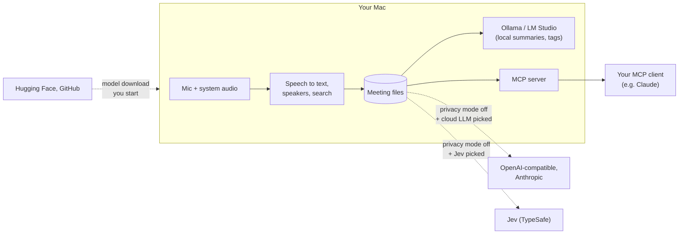

# Privacy

Mirona has **no telemetry, no analytics, no crash reporting and no accounts**. Nobody, including
the people who make Mirona, can see your meetings.

## What stays on your Mac

Recordings, transcripts, notes, summaries, voiceprints, search vectors and your corrections are
files on your Mac (your meetings folder and `~/Library/Application Support/com.nagare.mirona`).
Speech-to-text, speaker detection and search run locally. API keys and the encryption key are in
the macOS keychain.

## What can leave your Mac, and when

| What | When | Where to |
| --- | --- | --- |
| Model files (download only) | When you click Download in onboarding or Settings | Hugging Face, GitHub (and the download servers they redirect to). Fixed files, checked against pinned checksums. Nothing about you or your meetings is sent. |
| Transcript text for summaries, notes, follow-up drafts and agents' open questions | Only with privacy mode off and a cloud LLM picked (Anthropic, or an OpenAI-compatible server that isn't on this Mac) | That provider, with your API key |
| Transcript lines for tags and meeting questions, and agents' `ask_meeting` questions | Only with privacy mode off and Jev picked for classification | Jev (TypeSafe), with your API key |
| Meeting data for AI agents | Only to an MCP client you set up yourself. Agent access is on by default; turn it off in Settings › Agents (MCP) | The MCP client you connected, on this Mac. Your agent may then send it to its own provider. |

Solid arrows stay on your Mac or go to an agent you connected. Dotted arrows are the only
network traffic, and only in the cases shown.

**Privacy mode** is on by default. While it's on, every cloud provider is blocked at one network
gate in the code, and only this Mac (Ollama, LM Studio) can be reached. The model download is the
one exception, and only when you start it.

**Sensitive lines** (passwords, salaries, account and card numbers, health details, and lines the
classifier tags as sensitive) never go to a cloud model for summaries, notes or follow-up emails,
are never indexed for search by meaning, and show as `[redacted]` to AI agents unless the agent
asks for them (`include_sensitive`). To tag a line, the classifier has to read it first: with
privacy mode off and Jev picked, each line is sent to Jev once for tagging, including lines that
turn out to be sensitive. Keep privacy mode on for calls where that matters.

Mirona never checks for updates on its own. New versions are on the
[Releases](https://github.com/aryan-curiel/mirona/releases) page.

## Checking it yourself

[docs/privacy-audit.md](docs/privacy-audit.md) is the check run before each release. It records,
searches and calls every MCP tool with privacy mode on while watching every network connection.
You can run it too.

Found something that leaves when it shouldn't? See [SECURITY.md](SECURITY.md).
