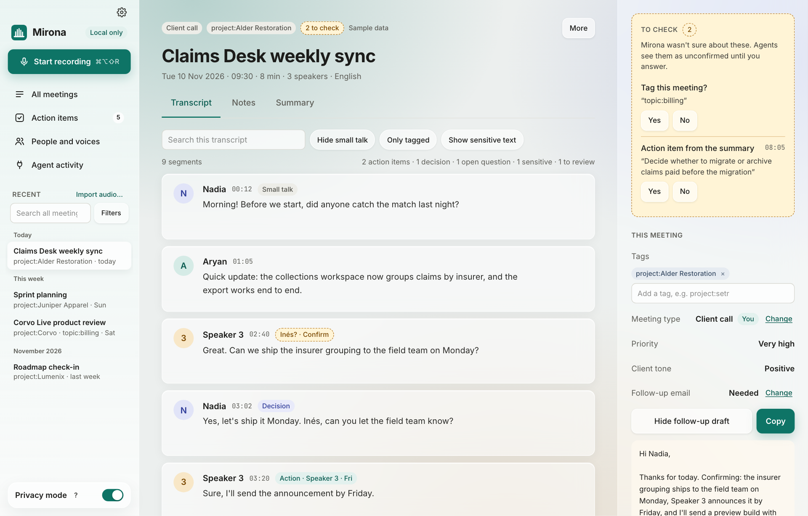
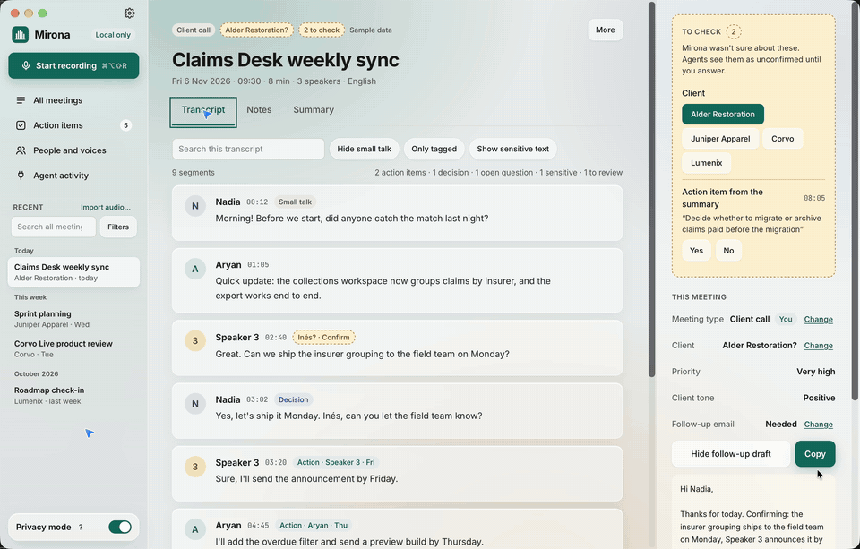

# Mirona

**Meeting memory that stays on your Mac.** Mirona records your calls, transcribes them on your
Mac, works out who said what, and keeps every meeting as Markdown files you own. Claude and other
AI agents can search them over MCP, if you let them.



- **Private by default.** Speech-to-text, speaker detection and search run on your Mac. Privacy
  mode (on from the start) blocks every cloud service at one network gate, and Mirona has no
  telemetry. Recordings can be encrypted at rest.
- **Files you own.** One folder per meeting: `meeting.md` (notes, summary, action items) and
  `transcript.jsonl`. Back them up, sync them, grep them.
- **Useful afterwards.** Action items, decisions and open questions link back to the moment they
  were said. Summaries follow templates you can edit, and follow-up emails are drafted for you.
- **Knows who spoke.** Speakers are split after the call. Name a voice once and Mirona recognises
  it in later meetings.
- **Ready for your agents.** An MCP server (stdio or localhost HTTP with per-client tokens), a CLI
  and a Claude Code skill. Sensitive lines (passwords, salaries, account numbers) stay out of
  summaries and search, and agents see them as `[redacted]` unless you allow it.

> **Status:** early. macOS 14.6+ on Apple silicon. Windows and Linux capture are on the roadmap.

## A quick tour



Inspect why a line was tagged, read the summary, see every action item across meetings, and
search by keywords and meaning. Shown with demo data.

## Install

1. Download the latest `Mirona_x.y.z_aarch64.dmg` from
   [Releases](https://github.com/aryan-curiel/mirona/releases), open it and drag Mirona to
   Applications.
2. Open Mirona. The first-run setup asks for the microphone and system audio, and downloads the
   speech and speaker models (about 1 GB, once).
3. Record from the sidebar, the menu bar, or <kbd>⌘⌥⇧R</kbd> from any app.

Summaries need a language model. The local default is [Ollama](https://ollama.com) with
`qwen3:4b` (`ollama pull qwen3:4b`). With privacy mode off you can use OpenAI or Anthropic
instead, with your own key.

## Docs

| | |
| --- | --- |
| [User guide](docs/user-guide.md) | Getting started, recording, speakers, tags, summaries and templates, search, privacy, settings, workflows, FAQ |
| [CLI and MCP](docs/cli-and-mcp.md) | The `mirona` CLI, MCP tools, setup for Claude Code, Claude Desktop, Cursor |
| [Architecture](docs/architecture.md) | Crates, the pipeline, where files live |
| [Adding a provider](docs/providers.md) | A new speech, speaker, classifier, LLM or embedding provider |
| [Privacy](PRIVACY.md) | What leaves your Mac, and when |
| [Contributing](CONTRIBUTING.md) | Build, test, open a PR |

## Build from source

Needs Rust (stable), Node 22+ with pnpm, and cmake.

```bash
cd app
pnpm install
pnpm tauri dev
```

Details, tests and project conventions are in [CONTRIBUTING.md](CONTRIBUTING.md).

## Roadmap

- **Now:** first public release (signed macOS build, docs, open-source setup).
- **Next:** Windows capture (WASAPI loopback), then Linux (PipeWire).

## License

[Apache-2.0](LICENSE). Model and third-party credits are in [NOTICE](NOTICE) and
[docs/licenses.md](docs/licenses.md).
