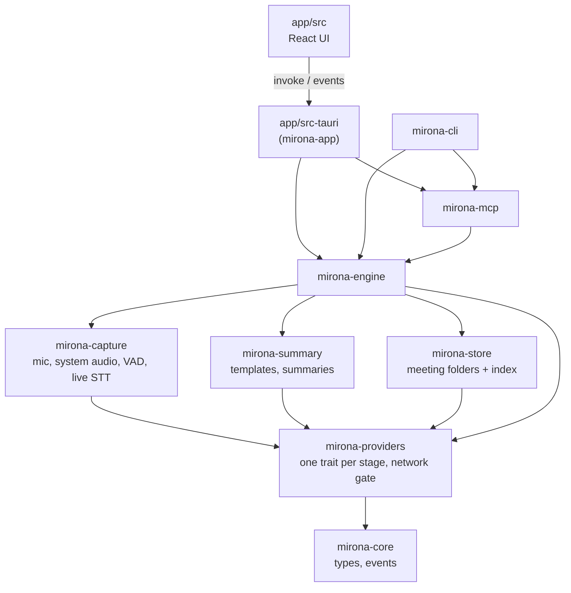
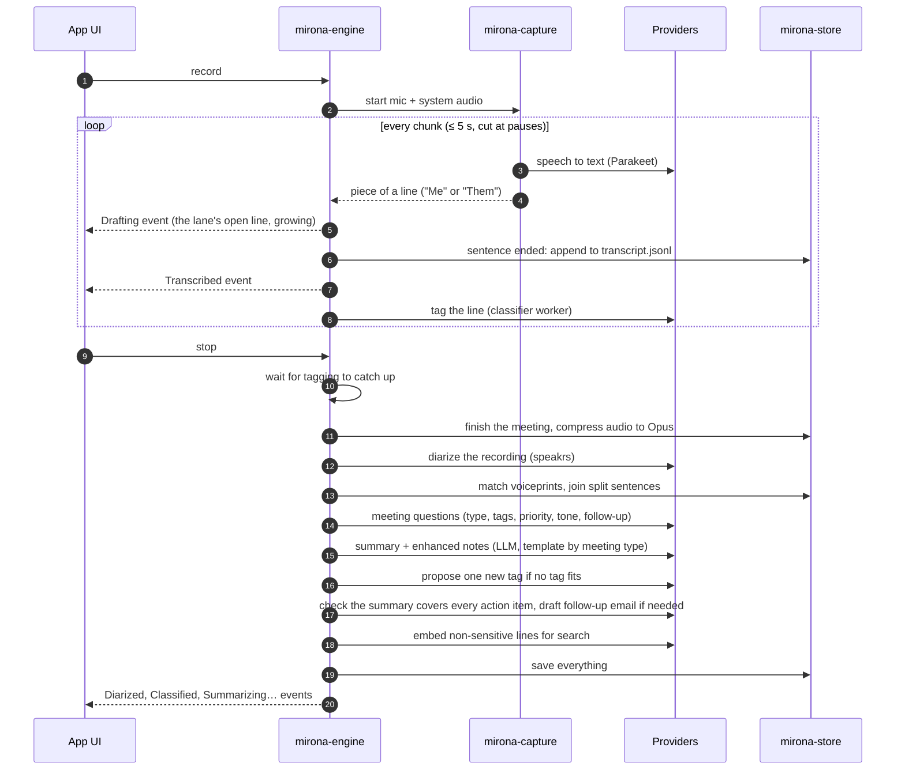
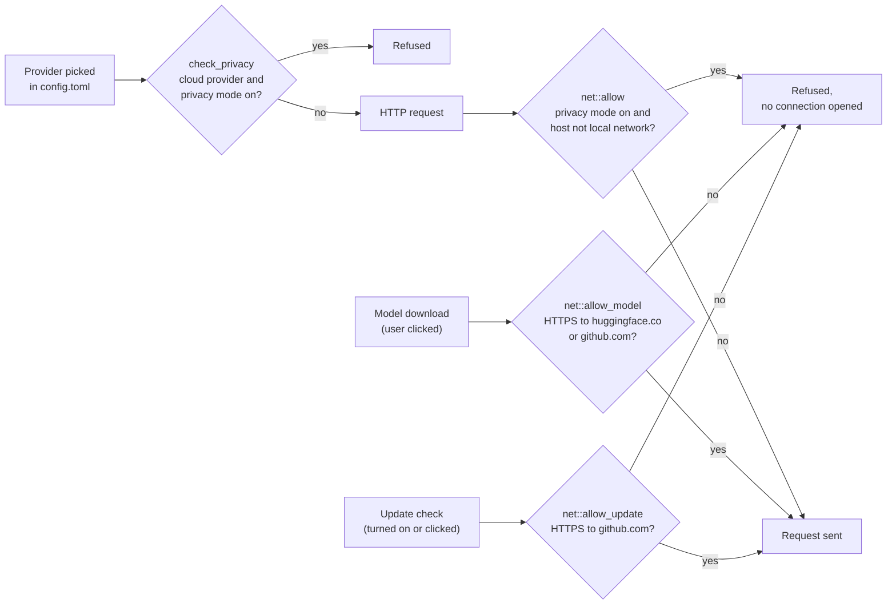

# Architecture

Mirona is a Rust workspace plus a Tauri 2 app with a React front end. The app, the `mirona` CLI
and the MCP server share one engine and read the same meeting folders.



Every crate also depends on `mirona-core`; those arrows are left out.

## Crates

| Crate | What it does |
| --- | --- |
| `mirona-core` | Domain types (`Meeting`, `Segment`, …) and `PipelineEvent`. Types export to TypeScript with `ts-rs` (`app/src/bindings/`). `Segment::is_sensitive` is the single rule for what stays out of summaries, cloud models, search vectors and agents (the classifier still reads each line once to tag it). |
| `mirona-providers` | One trait per stage (`SttProvider`, `Diarizer`, `Classifier`, `LlmProvider`, `Embedder`), the real providers behind features, deterministic fakes, `config.toml`, the keychain, and `net.rs`, the network gate. See [providers.md](providers.md). |
| `mirona-capture` | macOS capture: the mic and system audio (a Core Audio process tap) through `cpal`, resampling, Silero VAD chunking, live speech-to-text on a worker, Opus compression. Other OSes compile, but live capture returns an error there. |
| `mirona-store` | Meeting folders, the SQLite FTS5 index, hybrid search (keywords plus per-line vectors), optional encryption at rest, retention and deletion. |
| `mirona-summary` | Markdown summary templates, summaries and enhanced notes over any `LlmProvider`, with citations back to transcript lines. |
| `mirona-engine` | The pipeline: `Engine::record` → `Session::stop`, `import`, `summarize`, classification, search, retention and the model downloader. |
| `mirona-mcp` | The MCP server (`rmcp`), on stdio or localhost HTTP with per-client tokens. It rereads the store on every call. |
| `mirona-cli` | The `mirona` command. |
| `app/src-tauri` | Tauri commands over the engine; the tray, global shortcut, windows (main, Settings, onboarding, menu bar popover). |
| `app/src` | React 19, Tailwind v4, zustand. `lib/api.ts` wraps each command; `store.ts` holds the state and applies pipeline events. |

## A recording



1. **Capture.** Two streams, the mic ("Me") and system audio ("Them"), resampled to 16 kHz and
   cut into chunks of up to about 5 s at pauses.
2. **Live transcription.** Each chunk goes to the speech-to-text provider (Parakeet by default)
   on a worker. Each lane keeps one open line: a piece that continues its sentence (the same
   join rule as after stop) is added to it and sent as `Drafting`. When the sentence ends (a
   piece that doesn't continue it, 4 s with nothing new, or stop) the line is appended to
   `transcript.jsonl` in time order and sent as `Transcribed`.
3. **Live tags.** A classifier worker tags each finished line as action, decision, open
   question, small talk or sensitive, so pieces joined live are never tagged twice.
4. **After stop.** Tagging catches up, the audio is compressed to Opus, the recording is
   diarized (speakrs), speakers are matched against known voiceprints and each speaker's turn is
   joined into one line (pauses up to 2 s; only split sentences when no voices were separated).
   Lines still untagged are tagged, and each open question is asked again with the lines after
   it, so one answered later stops being open. Then the meeting-level questions are answered (type,
   priority, tone, follow-up, and a yes/no per tag), the LLM writes the summary and enhanced notes
   (and, when no tag fits, proposes one new tag for the user to accept), a check
   makes sure every action item is covered, and a follow-up email is drafted if one is needed.
   Last, lines that aren't sensitive are embedded for search.

Progress reaches the UI on the `pipeline` and `recording` event channels.

## Files

The folders are the source of truth. The index can always be rebuilt from them (`mirona reindex`).

```
~/Documents/Mirona/
  2026-11-05-0930-claims-desk-weekly-sync/
    meeting.md          YAML front matter (type, tags, speakers, action items…) + ## Notes
    transcript.jsonl    one line per segment, append-only
    audio.caf           Opus (audio.wav while recording): mic + system audio, for playback
    system.caf          system audio alone (system.wav while recording), for speaker detection
    embeddings.json     per-line search vectors
  .mirona/
    index.sqlite        FTS5 index, rebuilt from the folders
    labels.jsonl        your corrections, used as labelled examples
    voices.json         named speakers and their voiceprints
    recording.lock      one live recording per meetings folder (app and CLI)
    retention.log
```

With encryption on, `transcript.jsonl`, the audio, embeddings, voiceprints and corrections are
encrypted with XChaCha20-Poly1305. The audio of a call in progress (`audio.wav`) is sealed when
the recording stops. The key is in the keychain, and the index is kept in memory
only. `meeting.md` stays readable.

The app writes the index. The CLI and MCP server open a snapshot and never rewrite it, so they're
safe to run while the app is open.

## Privacy



Two checks, each in one place:

- `check_privacy` refuses any provider whose locality is `Cloud` while privacy mode is on.
- `net::allow` runs before every HTTP request; in privacy mode only this machine and the local network pass
  (`net::is_local`; Ollama on another computer serves summary, tags and search through
  `mirona_engine::ollama_url`). The
  exceptions are `net::allow_model` (model downloads the user starts, from pinned URLs) and
  `net::allow_update` (the update check the user turned on, to github.com only;
  `app/src-tauri/src/update.rs`).

[privacy-audit.md](privacy-audit.md) is the release check that proves it, socket by socket.

## Decisions

Architecture decisions are in [adr/](adr/); spike write-ups in [spikes/](spikes/).
