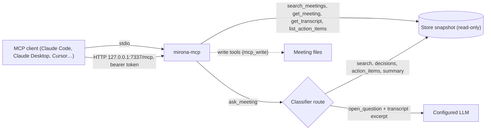

# CLI, MCP server and Claude Code skill (NGR-148, NGR-149, NGR-168)

The `mirona` CLI and the `mirona-mcp` server use the same engine and meeting folders as the
app. They read `config.toml` from the app folder (`~/Library/Application Support/com.nagare.mirona`
on macOS); set `MIRONA_APP_DIR` to use another one.

## Install

The app already contains the MCP server: `Mirona.app/Contents/MacOS/mirona-app mcp` serves on
stdio, no window. Releases are signed, notarized DMGs on
[GitHub Releases](https://github.com/aryan-curiel/mirona/releases) (`docs/releasing.md`).

The CLI, from a checkout:

```bash
cargo install --path crates/mirona-cli   # installs `mirona`
cargo install --path crates/mirona-mcp   # optional: standalone `mirona-mcp` (same as `mirona mcp`)
```

Homebrew: `packaging/homebrew/mirona.rb` (HEAD only, macOS) isn't in a tap yet. From a
checkout: `brew install --HEAD --formula ./packaging/homebrew/mirona.rb`.

## CLI

| Command | What it does |
|---|---|
| `mirona record` | Records mic + system audio, prints segments as they arrive; Ctrl-C or `mirona stop` ends it, then it summarizes. Needs Microphone and Screen & System Audio Recording access for the terminal app (asks once, fails with where to allow it if denied). Refuses if a recording is already running. |
| `mirona stop` | Stops a recording running in another terminal (`recording.lock` / `recording.stop` files in the app folder, so it works the same on Windows). Clears a stale lock if no recorder answers within 5 s. |
| `mirona list` | Meetings, newest first: id, date, title, client |
| `mirona show <id>` | Summary, decisions, open questions, action items, notes, transcript |
| `mirona search <words…> [--client X] [--from YYYY-MM-DD] [--to …] [--speaker X] [--tag action\|decision\|open-question\|small-talk\|sensitive] [--sensitive]` | Transcript moments by keywords and meaning (hybrid search, NGR-167), best first; with no moments, the matching meetings. Sensitive lines only with `--sensitive`. Without Ollama's `nomic-embed-text` it searches keywords only and says so |
| `mirona actions [--client X] [--open]` | Action items across meetings (`--client` is case-insensitive, part of the name is enough) |
| `mirona import <audio>` | Transcribes (wav/mp3/m4a/flac) and summarizes a file into a new meeting |
| `mirona reindex` | Rebuilds `<meetings>/.mirona/index.sqlite` from the files |
| `mirona privacy [on\|off]` | Shows or sets privacy mode, the same setting as the app's switch. `--privacy` on any command forces it on for that run without saving it |
| `mirona retention` | Applies the retention rules now (old recordings, old meetings per client) and prints what it removed; also logged to `<meetings>/.mirona/retention.log` |
| `mirona delete <id>` / `mirona delete --client X` | Deletes a meeting (or every meeting of a client) everywhere: folder, index, embeddings, voices heard only there, corrections |
| `mirona compress` | Compresses recordings still kept as `audio.wav` (older meetings, crashed sessions) to `audio.caf` (Opus); the app does this at start |
| `mirona mcp [--http [--port N]]` | The MCP server on stdio, or on `http://127.0.0.1:N/mcp` (default `mcp_port`, 7337) |
| `mirona eval [--with jev\|local-llm\|fake]… [--set file] [--no-labels] [--context] [--limit N]` | Scores the classifiers on the public synthetic set (`eval/chunks.jsonl`, or `--set`) plus your own corrections (`<meetings>/.mirona/labels.jsonl`, local only; `--no-labels` leaves them out): accuracy and precision/recall per question, latency per call. `--with` is repeatable; default: the configured classifier (Jev, unless privacy mode is on) plus the local baseline. `--with fake` needs no network (CI). `--context` puts the previous example's last two lines in front. Jev uses the keychain key, or `TYPESAFE_API_KEY` |

Read commands (`list`, `show`, `search`, `actions`, `eval`) and the MCP server index into
memory and never write the app's index, so they are safe to run while the app is open. Errors go
to stderr as `mirona: …` with exit code 1.

## MCP server



Every call rereads `config.toml` and the meeting folders, so it sees what the app just wrote and
works with the app closed. `mcp_enabled` is off until the user turns it on (onboarding, or
Settings › Agents (MCP) › MCP server); while it's off the server refuses to start, and calls fail
if it is turned off while running.

Sensitive lines (tagged by the classifier, or naming a password, a salary, an account number…)
read `[redacted]` everywhere. `include_sensitive` shows them only if the user allowed it
(`mcp_sensitive = true`, Settings › Agents (MCP) › Sensitive lines; off by default). Action
items said on such a line read `[redacted]` too. Classifier answers below their threshold are
marked (`needs_review`, `unconfirmed`), never served as fact.

### Tool reference

Results are compact JSON, except the transcript, which is plain text. Times are `m:ss` (or
`h:mm:ss`) from the start of the recording. Read tools:

- `search_meetings { query, client?, from?, to?, speaker?, tag?, include_sensitive? }`:
  transcript moments by keywords (prefix-matched) and meaning, best first, at most 30. Returns
  `moments` (`meeting_id`, `title`, `client`, `date`, `at`, `speaker`, `snippet` with keyword
  hits in `[brackets]`, `matched`: keywords, meaning or both), `moments_truncated`, `meetings`
  (`meeting_id`, `title`, `client`, `date`) and `search_by_meaning` (false without Ollama's
  `nomic-embed-text`). An empty `query` lists the meetings that pass the filters, newest first.
  `from`/`to` are `YYYY-MM-DD` (inclusive); `tag` is `action`, `decision`, `open_question`,
  `small_talk` or `sensitive`; `client` and `speaker` match part of the name.
- `ask_meeting { question, meeting_id? }`: a plain question, routed by the classifier (a keyword
  rule when classification is off or unreachable). Returns `route`, `routed_by` and, per route:
  `search` → `moments` (up to 10); `decisions` → `meetings` with their `decisions`;
  `action_items` → `action_items` (open ones, or all of `meeting_id`'s); `summary` → `meeting`
  (as `get_meeting`); `open_question` → `answer`, `written_by` and the `meetings` used. Only
  `open_question` calls the configured LLM, with up to ~24k characters of transcript from up to
  3 meetings. Without `meeting_id` it uses the meetings the question's search hits come from,
  else the newest.
- `get_meeting { id }`: `id`, `title`, `client`, `date`, `duration_min`, `speakers` (`id`,
  `name`), `transcript_segments`, `overview`, `decisions`, `open_questions`, `action_items`
  (`id`, `text`, `owner`, `due`, `done`, `at`, `needs_review`), `notes`, `enhanced_notes`,
  `summary_by`, `meeting_type` (only when confirmed or above threshold) and `unconfirmed`
  (classifier guesses below threshold). No transcript.
- `get_transcript { id, from?, to?, include_sensitive? }`: a `# title · client · date` line, then
  `[m:ss] Speaker: text` lines. `from`/`to` (`to` exclusive) take `m:ss`, `h:mm:ss` or seconds.
- `list_action_items { client?, open_only? }`: `count` and `items` (`id`, `text`, `owner`,
  `due`, `done`, `client`, `meeting_id`, `meeting`, `at`, `needs_review`), newest meeting first.

Write tools, listed and callable only with `mcp_write = true` (Settings › Agents (MCP) ›
Write tools; off by default). They change the meeting files the way the app does, and the open
app picks the change up within a few seconds:

- `set_action_item_done { id, done }`: mark an action item done, or open again. Returns `id`,
  `text`, `done`.
- `rename_speaker { meeting_id, speaker_id, name }`: name a speaker (ids from `get_meeting`'s
  `speakers`); like naming them in the app, the name follows the voice to other meetings, and a
  name a known person already has merges the voice into them. Returns `id`, `name`.

### Activity log

Every tool call, on either transport, appends one line to `<app dir>/mcp-activity.jsonl`:
`{"time", "client", "tool", "ok"}`, where `client` is `stdio` or the HTTP client's name. Never
arguments or results. Past 1 MB the log is cut to its newest 1000 lines. The app shows it on the
Agent activity page in the sidebar.

### Claude Code

```bash
# With the app installed, nothing else needed (Settings › Agents (MCP) shows the exact line):
claude mcp add mirona -- /Applications/Mirona.app/Contents/MacOS/mirona-app mcp
# Or with the CLI installed:
claude mcp add mirona -- mirona mcp
# or, without the CLI on PATH:
claude mcp add mirona -- /path/to/mirona-mcp
```

### Claude Desktop

`~/Library/Application Support/Claude/claude_desktop_config.json`. Use an absolute path (the
app binary as above, or `which mirona`): Claude Desktop does not use your shell's PATH.
Settings › Agents (MCP) shows the ready snippet.

```json
{
  "mcpServers": {
    "mirona": { "command": "/Applications/Mirona.app/Contents/MacOS/mirona-app", "args": ["mcp"] }
  }
}
```

### Over HTTP

For clients that connect to a URL rather than start a process. It listens on `127.0.0.1` only,
at `/mcp` (404 elsewhere), and every request needs `Authorization: Bearer <token>` (401
otherwise; 503 while `mcp_enabled` is off). Each client gets its own token, so the activity log
shows who called what and one client can be cut off alone.

1. Settings › Agents (MCP) › MCP over HTTP: turn it on (`mcp_http`; the app runs the server
   while it is open) and pick the port (`mcp_port`, default 7337). `mirona mcp --http` runs it
   without the app, whatever `mcp_http` says. Either fails at once if the port is taken.
2. Settings › Agents (MCP) › Client tokens: type a name (e.g. "Claude Desktop") and Create
   token. The token is shown once, with a ready `claude mcp add` line. Tokens live in
   `config.toml` under `[mcp_tokens]` (name = token); Revoke removes one and takes effect on the
   next request.

```bash
claude mcp add --transport http mirona http://127.0.0.1:7337/mcp \
  --header "Authorization: Bearer <token>"
```

Other clients take the URL `http://127.0.0.1:7337/mcp` plus that header (e.g. Cursor's
`mcp.json`: `{"mcpServers": {"mirona": {"url": "…", "headers": {"Authorization": "Bearer …"}}}}`).

## Claude Code skill

`skills/mirona/SKILL.md` teaches Claude when to use the tools (preparing for a meeting, finding
what a client agreed, turning action items into tasks). Install it for every project:

```bash
mkdir -p ~/.claude/skills && cp -R skills/mirona ~/.claude/skills/
```

or for one project, copy it to `<project>/.claude/skills/mirona/`. It needs the MCP server above.
