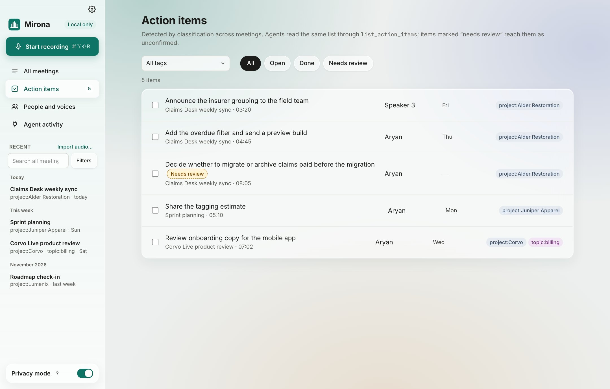
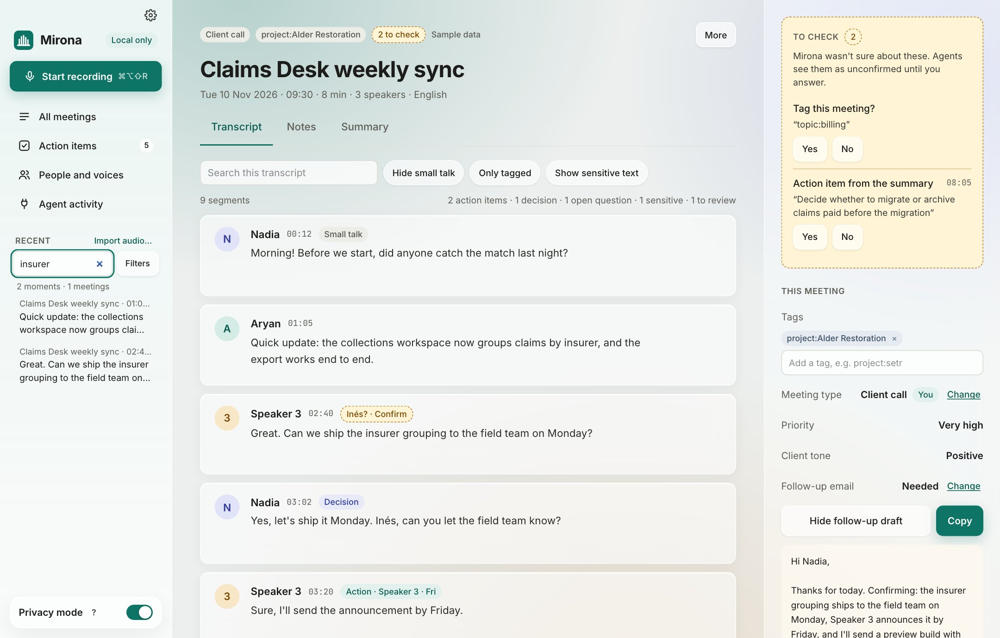
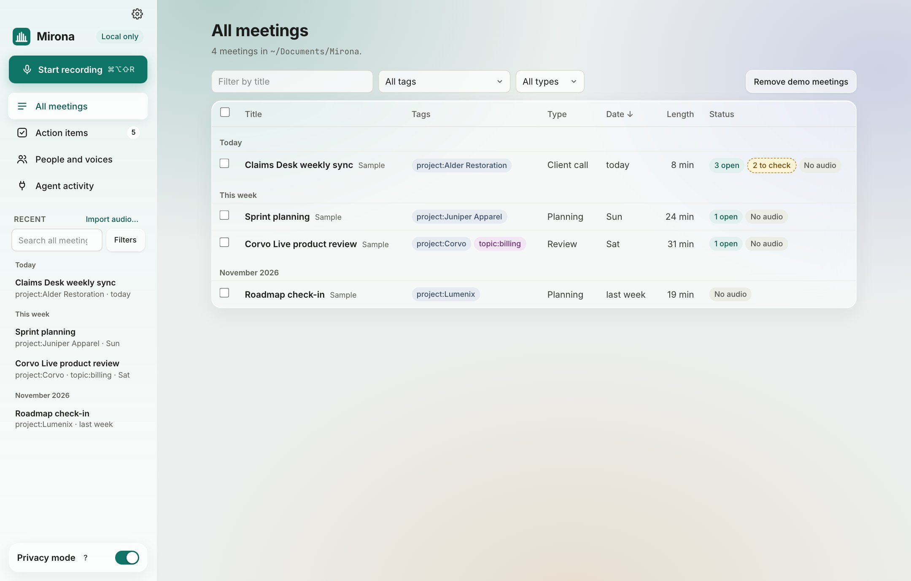

# Action items, search and all meetings

## Action items

**Action items** in the sidebar lists every promise from every meeting in one place, with a count
of open ones next to it.



- Each item shows what was promised, the meeting and the moment it was said (click to jump
  there), the **owner** and **due date** when someone said them, and the meeting's tags.
- **All tags** narrows the list to one client or project. **All / Open / Done / Needs review**
  filter by state.
- Tick the box to mark an item done. It's saved in the meeting's `meeting.md`.
- *Needs review* means Mirona isn't sure the line is an action item. Answer it in the meeting's
  **To check**.

Where items come from:

- the summary's action items
- lines the classifier is sure are action items, even when the summary left them out. They're
  reworded as a short task by the summary model (a sensitive line keeps its own words and never
  goes to a cloud model for this), and they survive regenerating the summary
- lines you mark as an action yourself in the inspector

From the terminal: `mirona actions --open --tag project:` lists open items for every project.

## Search

**Search all meetings** at the top of the sidebar matches **words and meaning** across everything
you've recorded. Type and press <kbd>Enter</kbd>:



- Results are **moments**: the line, who said it, the meeting and the time. Click one to open the
  meeting at that line.
- **Filters** narrows by meeting tag, line tag (*Any line*, action, decision, open question…),
  dates (**From** / **To**) and **Speaker**.
- Sensitive lines are never shown in results (*Sensitive line hidden*).

### Search by meaning

Keyword search always works. Search by meaning also finds lines that say the same thing in other
words ("pricing" finds "how much it costs"). It needs Ollama with the `nomic-embed-text` model:

```bash
ollama pull nomic-embed-text
```

Lines are indexed after each call, and older meetings are indexed when the app starts. Embeddings
are made on your Mac and stored in each meeting's folder (`embeddings.json`). Sensitive lines are
never indexed.

### Search examples

| You type | Finds |
| --- | --- |
| `insurer grouping` | Lines that mention it, then lines about the same thing |
| `deadline` + Filters › line tag: action | Promises with a date attached |
| `pricing` + Filters › meeting tag: `project:corvo` | Pricing talk in one project's calls |
| `migration` + From: last month | Recent discussions only |
| `budget` + Speaker: Nadia | What one person said about it |

From the terminal: `mirona search budget --speaker Nadia --from 2026-10-01`.

## All meetings

**All meetings** lists every meeting as a table:



- **Filter by title**, **All tags** and **All types** narrow the list. Click a column header to
  sort.
- **Status** shows open action items, answers waiting for review, *No audio* (removed by a
  retention rule or by you) and *No summary*.
- Tick meetings (or **Select all shown**) and **Delete N selected…** to delete several at once.
- **Remove demo meetings** appears while demo meetings are present.

The sidebar lists your newest meetings, grouped by day. **See all N meetings** at the bottom
opens this page.
