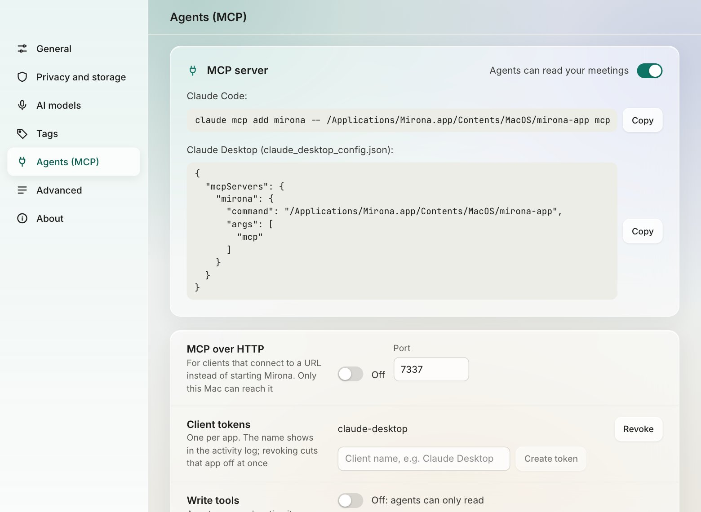
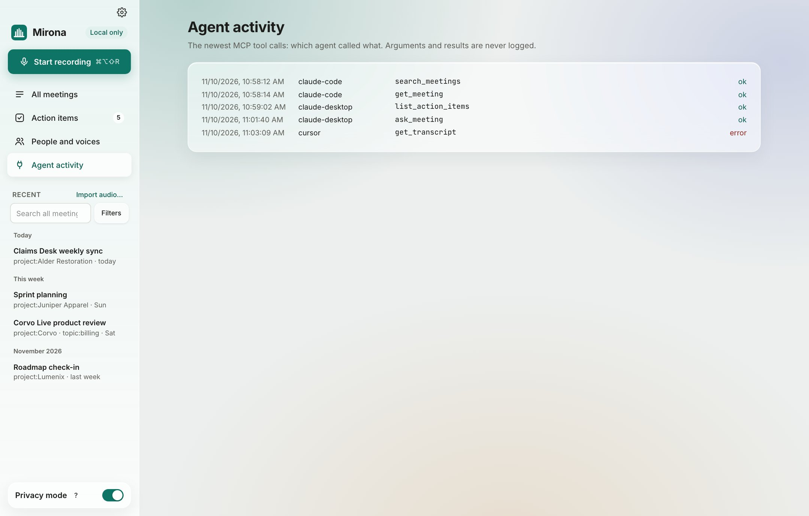

# AI agents (MCP)

Mirona can serve your meetings to Claude and other AI agents over
[MCP](https://modelcontextprotocol.io), so you can ask "what did the client agree last week?"
from the assistant you already use. It's **off until you turn it on**.

This page covers setup and examples. [CLI and MCP](../cli-and-mcp.md) has the full tool reference.

## Turn it on

Settings › **Agents (MCP)** › MCP server › **Agents can read your meetings**:



The page shows the exact setup line for your install, with **Copy** buttons.

### Claude Code

```bash
claude mcp add mirona -- /Applications/Mirona.app/Contents/MacOS/mirona-app mcp
```

For better results, also install the Mirona skill, which teaches Claude when to use each tool:

```bash
git clone https://github.com/aryan-curiel/mirona && mkdir -p ~/.claude/skills \
  && cp -R mirona/skills/mirona ~/.claude/skills/
```

### Claude Desktop

Add this to `~/Library/Application Support/Claude/claude_desktop_config.json`, then restart
Claude Desktop:

```json
{
  "mcpServers": {
    "mirona": { "command": "/Applications/Mirona.app/Contents/MacOS/mirona-app", "args": ["mcp"] }
  }
}
```

### Cursor and other clients (over HTTP)

For clients that connect to a URL:

1. Turn on **MCP over HTTP** and pick a port (7337 by default). It listens on this Mac only.
2. Under **Client tokens**, type a name (e.g. "Cursor") and **Create token**. The token is shown
   once.
3. Point the client at `http://127.0.0.1:7337/mcp` with the header
   `Authorization: Bearer <token>`.

Each client gets its own token, so the activity log shows who called what, and **Revoke** cuts
one client off without touching the others.

## What agents can do

| Tool | What it's for |
| --- | --- |
| `search_meetings` | Find moments by words and meaning, with the same filters as the app |
| `get_meeting` | A meeting's summary, decisions, action items, notes and speakers |
| `get_transcript` | The transcript, or part of it |
| `list_action_items` | Action items across meetings, by tag, open only |
| `ask_meeting` | A plain question, routed to the right lookup (or to your summary model for open questions) |

With **Write tools** on (off by default), agents can also mark action items done and rename
speakers. Everything else is read-only.

What agents never see:

- **Sensitive lines** read `[redacted]`, unless you turn on **Sensitive lines**.
- **Unconfirmed answers** (things in To check) are marked as unconfirmed, never served as fact.

## Things to ask

Once connected, ask in plain words. Some examples:

- "What did we agree with Alder Restoration in the last two calls?"
- "List my open action items for project:Corvo and turn them into a checklist."
- "Prepare me for tomorrow's roadmap check-in: what's still open from last time?"
- "Who asked about the data export for legal, and did anyone answer?"
- "Draft a status update for Juniper Apparel from this week's meetings."
- "Mark the 'send a preview build' action item as done." *(needs Write tools)*
- "Speaker 3 in today's Claims Desk sync is Inés; rename her." *(needs Write tools)*

Your agent may send what it reads to its own model provider. That's between you and your agent;
Mirona only serves it on your Mac.

## Agent activity

**Agent activity** in the sidebar logs every tool call: when, which client and which tool, and
whether it worked. Arguments and results are never logged.



## From the terminal

The same engine is available as the `mirona` command (`list`, `show`, `search`, `actions`,
`import`, `record`…). See [CLI and MCP](../cli-and-mcp.md).
