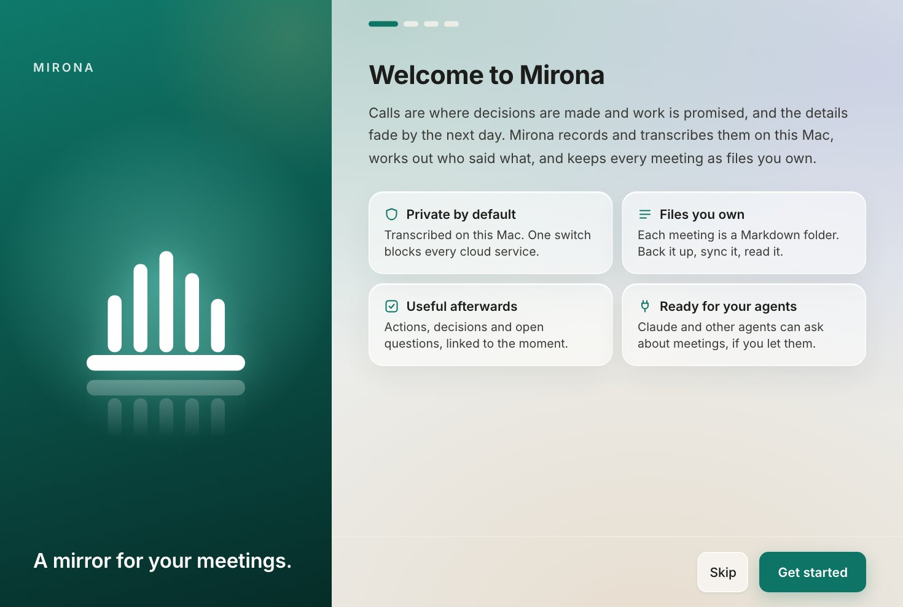
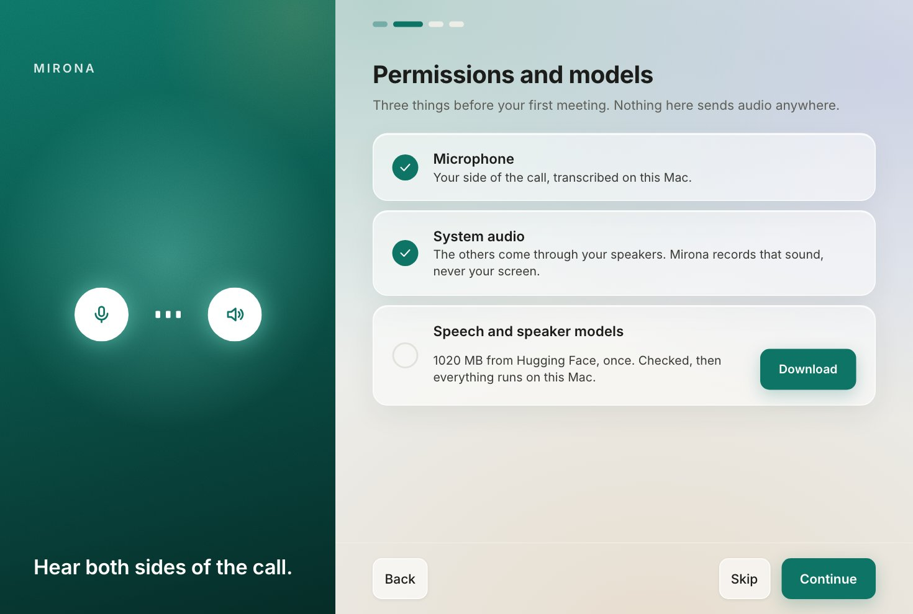
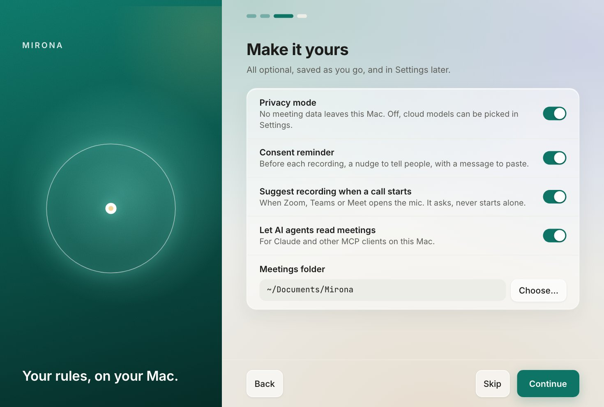
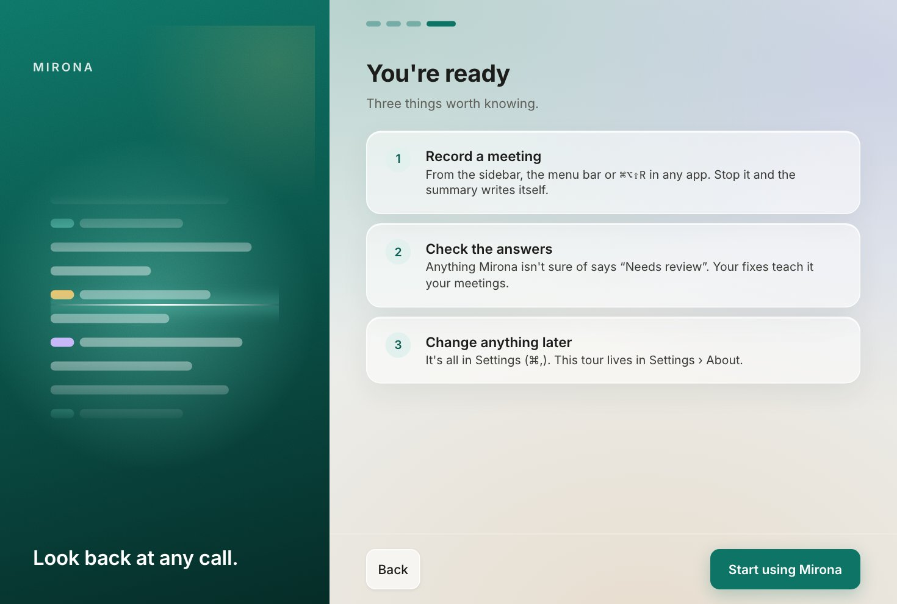

# Getting started

This page takes you from download to your first summarized meeting, in about ten minutes.

## What you need

- A Mac with Apple silicon (M1 or later) and **macOS 14.6** or later.
- About **1 GB** of free disk space for the speech and speaker models (about 700 MB on Macs with
  less than 16 GB of memory), plus room for your recordings: an hour of audio is about 11 MB once compressed.
- **[Ollama](https://ollama.com)** for summaries, unless you plan to use a cloud model. Ollama runs
  language models on your Mac.

Windows and Linux builds are on the roadmap. Until then, Mirona records only on macOS.

## 1. Install Mirona

1. Download the latest `Mirona_x.y.z_aarch64.dmg` from
   [Releases](https://github.com/aryan-curiel/mirona/releases).
2. Open it and drag **Mirona** to **Applications**.
3. Open Mirona from Applications. Releases are signed and notarized, so macOS opens them without
   warnings.

## 2. Install Ollama and the models it needs

Mirona writes summaries, enhanced notes and follow-up emails with a language model. The default is
`qwen3:4b`, running in Ollama on your Mac. Install Ollama from [ollama.com](https://ollama.com),
then in Terminal:

```bash
ollama pull qwen3:4b          # summaries, notes, follow-up emails, local tagging (~2.5 GB)
ollama pull nomic-embed-text  # optional: search by meaning (~270 MB)
```

Mirona never downloads Ollama models itself; it uses the copy Ollama already has. Without
`nomic-embed-text`, search still works, by keywords only.

> **Prefer a cloud model?** Turn privacy mode off and pick OpenAI-compatible or Anthropic in
> Settings › AI models, with your own API key. See [Summaries and models](summaries.md).

## 3. The first-run setup

The first time you open Mirona, a short setup runs before the main window.

**Welcome.** What Mirona does, in four points.



**Permissions and models.** Three things before your first meeting:

- **Microphone:** your side of the call.
- **System audio:** everyone else, as it comes through your speakers or headphones. Mirona
  records the sound, never the screen. macOS lists this under *Screen & System Audio Recording*.
- **Speech and speaker models:** click **Download**. Files come from Hugging Face and GitHub,
  are checked one by one against pinned checksums, and the download resumes if you cancel or lose
  the connection. Already have them from another Mirona install? Point Settings › AI models ›
  Models folder at that folder and only missing files are fetched.



**Make it yours.** Privacy mode, the consent reminder, call detection, whether AI agents may
read your meetings, and the meetings folder. Everything here can be changed later in Settings.



**You're ready.** Three things worth knowing, then **Start using Mirona**.



You can skip the setup. Until the permissions and models are in place, the sidebar shows
**Finish setup**, which brings you back. Settings › About › **Show the welcome tour** replays it
at any time.

## 4. Try it with demo meetings

Want to look around before recording? Before your first meeting, the main window offers
**Add demo meetings**, which adds four made-up meetings (a client call, a sprint planning, a product review and a roadmap check-in)
with transcripts, tags, summaries and action items. Every screenshot in this guide uses them.
Demo meetings are marked *Sample data*, and **Remove demo meetings** on the All meetings page
takes them all away again.

## 5. Record your first meeting

1. Join a call in Zoom, Teams, Meet or any other app. (Or just talk: with nobody else on the line,
   Mirona records your mic only.)
2. Click **Start recording** in the sidebar, or press <kbd>⌘⌥⇧R</kbd> from any app.
3. The [consent reminder](recording.md#the-consent-reminder) asks what the call is about and offers
   a message to paste in the chat. Click **Start recording**.
4. Watch the transcript appear. Write notes in the **Notes** tab if you like.
5. Click **Stop and summarize** (or press <kbd>⌘⌥⇧R</kbd> again).

A minute or two later the meeting has speakers, tags, a summary, action items and, when one is
needed, a drafted follow-up email. [Recording](recording.md) explains each step, and
[A meeting, explained](meetings.md) walks through what you get.

## Next steps

- [Recording](recording.md): every way to start, mute, stop and import.
- [Speakers and voices](speakers.md): name a voice once, and Mirona recognises it later.
- [Tags](tags.md): sort meetings by client, project or topic, automatically.
- [Common workflows](workflows.md): how people use Mirona day to day.
- [FAQ and troubleshooting](faq.md): when something doesn't work.
