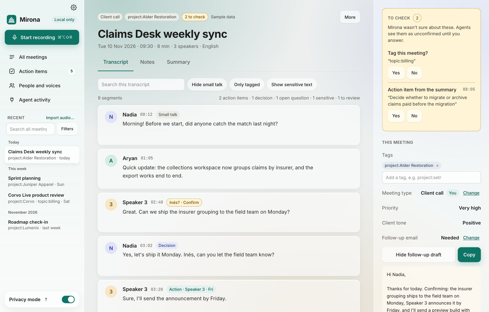
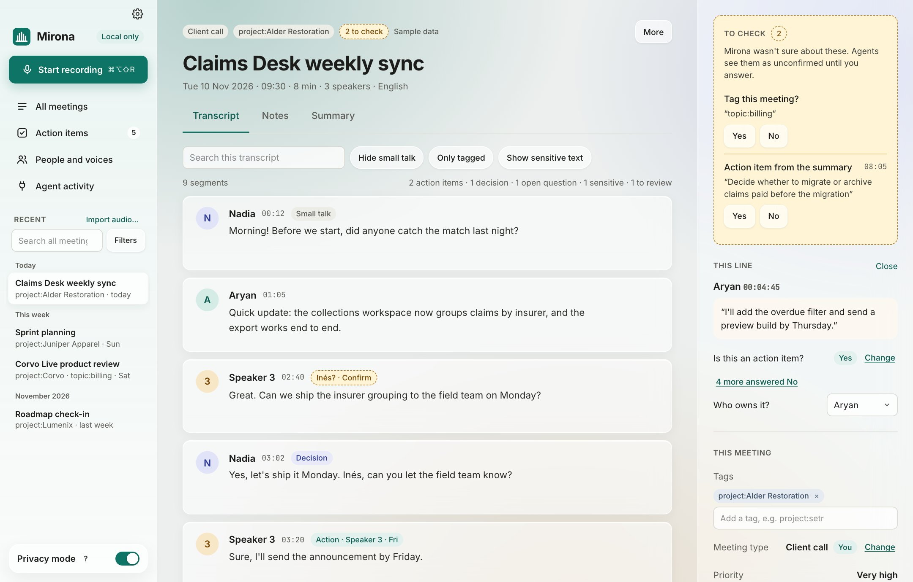
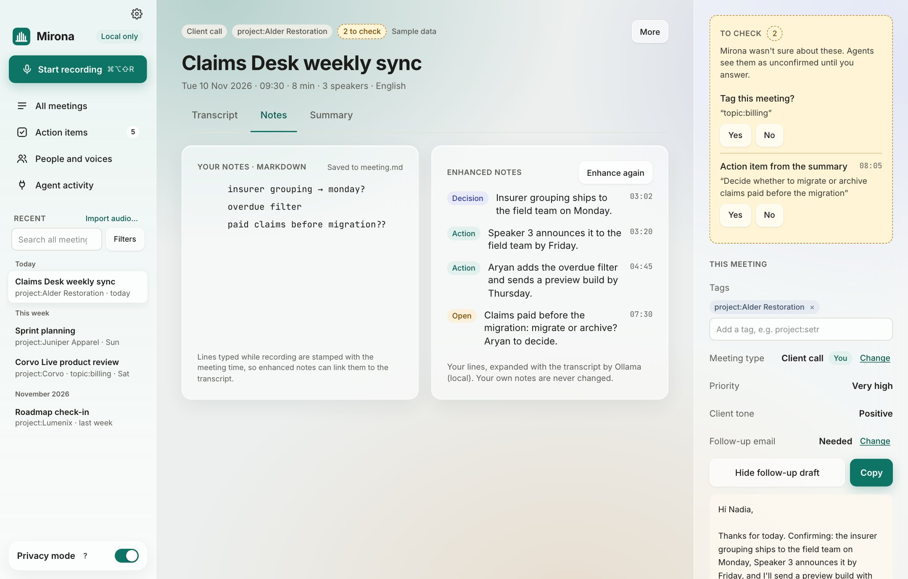
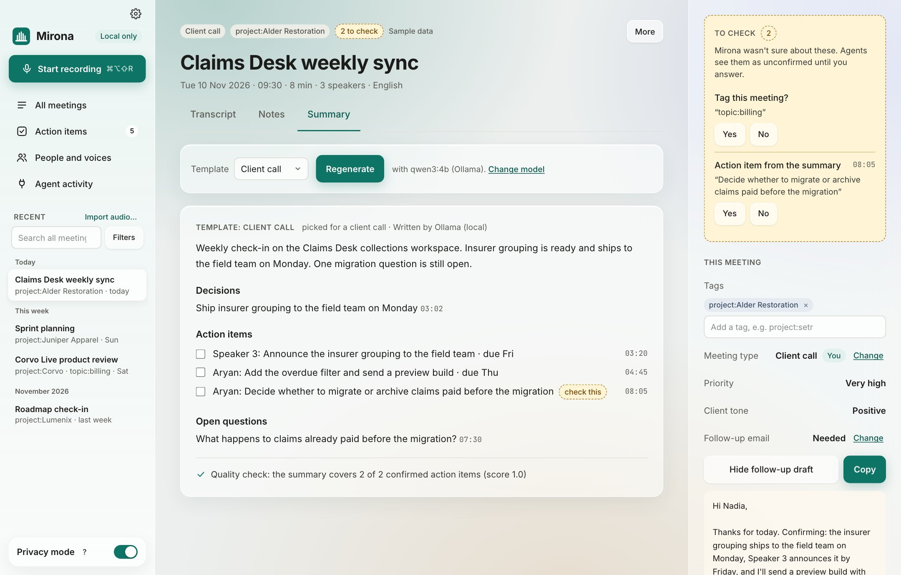

# A meeting, explained

Click a meeting in the sidebar to open it. A meeting has three tabs (**Transcript**, **Notes**
and **Summary**) and the **inspector** on the right, which shows what Mirona noted and what it
wants you to check.

## The header

- **Chips:** the meeting type (*Client call*), its tags, how many answers are waiting for you
  (*2 to check*) and *Sample data* on demo meetings.
- **Title:** click it to rename the meeting. <kbd>Enter</kbd> saves, <kbd>Esc</kbd> cancels.
- **Date, time, length, number of speakers and language.**
- **More:**
  - **Re-run speaker detection**: split the speakers again (lines you moved by hand keep their
    person).
  - **Re-run classification**: tag every line and answer the meeting questions again. Answers you
    gave stay.
  - **Remove or delete…**: remove parts Mirona generated (the recording, the summary and action
    items, the enhanced notes, or the tags and classification) while keeping the transcript and your
    notes, or delete the whole meeting. Deleting removes the folder, audio, transcript, notes,
    search vectors, voices heard only in this meeting and your corrections. It can't be undone.

## Transcript

Every line has its speaker, the time it was said and its tags:

| Tag | Means |
| --- | --- |
| **Action** · owner · due | Someone promised to do something. The owner and due date are filled in when they were said. |
| **Decision** | Something was agreed. |
| **Open question** | A question nobody answered. |
| **Small talk** | Chit-chat, kept out of summaries. |
| **Sensitive** | A password, salary, account number, health detail and so on. Hidden until you click **Show sensitive text**, and kept out of summaries, search and agents. |
| **Needs review** | Mirona thinks it might be one of the above, but isn't sure. |

Above the transcript:

- **Search this transcript** filters the lines as you type.
- **Hide small talk**, **Only tagged** and **Show sensitive text** narrow what you see.
- The counts on the right (*2 action items · 1 decision…*) sum up the tags.

Hover a line for more:

- **Fix text**: correct what the speech model misheard. The fix is saved in the transcript.
- **Who said this?**: move just this line to someone else, or to a new name. See
  [Speakers and voices](speakers.md#a-line-went-to-the-wrong-person).

Click a timestamp to play the recording from that moment (while the meeting still has its audio).

### Inspecting a line

Click a line to see, in the inspector, what Mirona decided about it:

- Each question it asked (*Is this an action item?*, *Is this a decision?*…) with its answer.
  **Change** flips an answer. Questions answered *No* are folded away under *N more answered No*.
- **Who owns it?** for action items: pick the person responsible.
- **Show model details** (at the bottom of the inspector) adds bars showing how sure the
  classifier was, with a mark at the threshold.

Every answer you change is kept as a labelled example in your meetings folder
(`.mirona/labels.jsonl`). `mirona eval` uses them to show how well the classifier does on *your*
meetings. Settings › Advanced › Your corrections shows how many you've made.

## To check

When Mirona isn't sure about something, it asks instead of guessing. The **To check** box at the
top of the inspector lists those answers, each with **Yes** and **No**:

- *Tag this meeting?* "topic:billing"
- *Action item from the summary*: "Decide whether to migrate or archive…"
- *New tag?* when none of your tags fit (see [Tags](tags.md#suggested-tags)).
- Who an unknown voice might be (*Inés? · Confirm* on the line itself).

Until you answer, AI agents see these as unconfirmed. Each question has two levels in Settings ›
Advanced › Thresholds:

- **Approve at** (0.85 by default; 0.95 for decisions): at or above it, an answer is filed as fact.
- **Reject below** (0.60 by default): below it, the answer counts as "no" without asking.

Answers in between go to **To check**. Rejected ones are only counted ("*N rejected for low
confidence*"), and **Show** lists them so you can still say Yes to one. Sensitive lines are never
rejected without asking.

## This meeting

Below To check, the inspector lists the answers about the whole meeting:

- **Tags**: × removes one; type in the box to add one. Suggestions match any part of a tag: "setr",
  "proj" or even "pset" find `project:setr`. Use the arrow keys and Enter, or press Enter on new
  text to create a tag.
- **Meeting type**: *Client call*, *Standup*, *1:1*, *Planning*, *Other*, or one of
  [your own templates](summaries.md#your-own-templates). **Change** picks another. *You* means
  you confirmed it.
- **Priority** (Nothing to do → Critical) and **Client tone** (Very unhappy → Delighted).
- **Follow-up email**: whether one is needed. **Show follow-up draft** opens the draft Mirona
  wrote, and **Copy** puts it on the clipboard for your mail app. If you change *Not needed* to
  *Needed*, the draft is written in the background.

## Notes

- **Your notes** are plain Markdown, saved in `meeting.md` as you type. Lines you type while
  recording are stamped with the time.
- **Enhanced notes** are your lines expanded with what the transcript says, each tagged
  (decision, action, open question) and linked to its moment. **Enhance again** rewrites them.
  Your own notes are never changed.

## Summary

The summary follows a **template**, picked by the meeting type. It has an overview, decisions,
action items (with owner and due date) and open questions. Every point carries a timestamp: click
it to jump to that line in the transcript.

- **Template** and **Regenerate** rewrite the summary with another template. *Change model* opens
  Settings › AI models.
- **Quality check** at the bottom says whether the summary covers every confirmed action item.
  A line that's clearly an action item but that the summary left out gets an item of its own.
- Tick an action item here or on the [Action items](actions-and-search.md) page to mark it done.
- Sensitive lines never reach the summary.

Summaries, notes and action items are also written into `meeting.md` as readable Markdown. See
[Files and folders](files.md).
