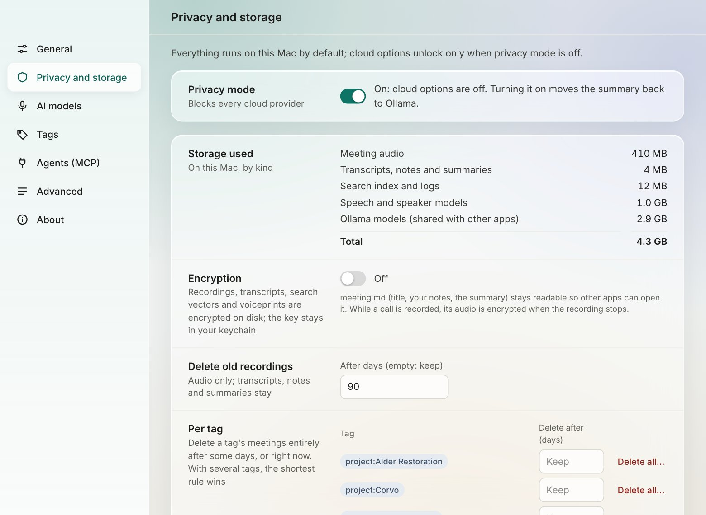

# Privacy, encryption and retention

Mirona has no telemetry, no analytics, no crash reporting and no accounts. Your meetings are
files on your Mac. This page covers the controls you have; [PRIVACY.md](../../PRIVACY.md) lists
exactly what can leave your Mac, and when.

## Privacy mode

**On by default.** The switch is at the bottom of the sidebar and in Settings › Privacy and
storage. While it's on:

- every cloud provider is blocked at one network gate in the code, so only this Mac or a
  computer on your local network (Ollama, LM Studio and other local servers) can be reached
- classification uses the local model instead of Jev, so tags are somewhat less accurate
- the sidebar badge reads **Local only**

Two things still reach the internet in privacy mode, and only when you start them: the **model
download** (fixed files from Hugging Face and GitHub) and the **update check** (GitHub; only if
you turned it on in Settings › About, or clicked Check now). Neither sends anything about your
meetings.

Turning privacy mode off doesn't send anything by itself. It allows the cloud models you pick in
Settings › AI models, with your own keys.

## Sensitive lines

A line is **sensitive** when the classifier tags it so, or when it mentions a password, salary,
account or card number, or health details. Sensitive lines:

- are hidden in the transcript until you tick **Show sensitive text**
- stay out of summaries, enhanced notes and follow-up emails
- are never sent to a cloud model for rewording
- are never indexed for search by meaning, and never shown in search results
- show as `[redacted]` to AI agents, unless you allow agents to read them (Settings ›
  Agents (MCP) › Sensitive lines, off by default)

To tag a line, the classifier has to read it. With privacy mode off and Jev picked, each line is
sent to Jev once for tagging. Lines with an obvious password, salary or account number are tagged
on your Mac first and never sent. Keep privacy mode on for calls where that matters.

## Storage, encryption and retention

Settings › **Privacy and storage**:

### Storage used

How much disk Mirona takes on this Mac, by kind: meeting audio; transcripts, notes and summaries;
the search index and logs; the speech and speaker models; and Ollama's models (shared with other
apps), with a total.

### Encryption

Turn on **Encryption** to encrypt recordings, transcripts, search vectors, voiceprints and your
corrections on disk (XChaCha20-Poly1305). The key is created for you and kept in the macOS
keychain. While encryption is on, the search index lives in memory only.

- `meeting.md` (title, your notes, the summary) stays readable, so other apps can still open it.
- The audio of a call in progress is encrypted when the recording stops.
- Turning encryption off decrypts the files again.

> **Keep the key safe.** The key is in your login keychain (service `mirona`, account
> `store-key`). Encrypted meetings can't be read without it, so if you move them to another Mac or
> erase this one, bring the key along (Keychain Access can show and copy it), or turn encryption
> off first.

### Delete old recordings

Set **After days** to delete meeting **audio** after that many days. Transcripts, notes and
summaries stay, so you keep everything searchable while freeing most of the space. Leave it empty
to keep audio forever.

### Per tag

Delete a tag's meetings **entirely** after some days, for example `project:Alder Restoration`
after 365 days when the contract says so. **Delete all…** removes a tag's meetings right now.
With several tags on one meeting, the shortest rule wins.

Retention runs when the app starts and every hour while it's open. Everything it removes is logged in
`<meetings folder>/.mirona/retention.log`. From the terminal, `mirona retention` runs it now and
prints what it removed.

## Deleting things

| To remove | Do this |
| --- | --- |
| One meeting | Meeting › **More** › **Remove or delete…** › Delete the whole meeting |
| Several meetings | **All meetings**, tick them, **Delete N selected…** |
| Just the audio, summary, notes or tags of a meeting | **More** › **Remove or delete…**, pick the parts |
| Everything about one client | Settings › Privacy and storage › Per tag › **Delete all…** |
| A person's voiceprint | **People and voices** › their card › **Delete** |
| Everything | Quit Mirona, delete the meetings folder and `~/Library/Application Support/com.nagare.mirona` |

Deleting a meeting removes its folder, audio, transcript, notes, search vectors, voices heard only
there and your corrections, everywhere. It can't be undone.

## Checking it yourself

[docs/privacy-audit.md](../privacy-audit.md) is the check run before each release: record, search
and call every agent tool with privacy mode on, while watching every network connection. You can
run it too.
