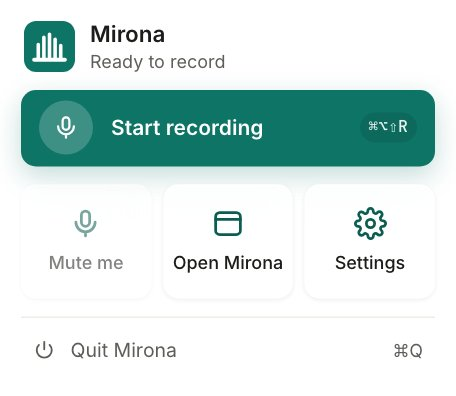
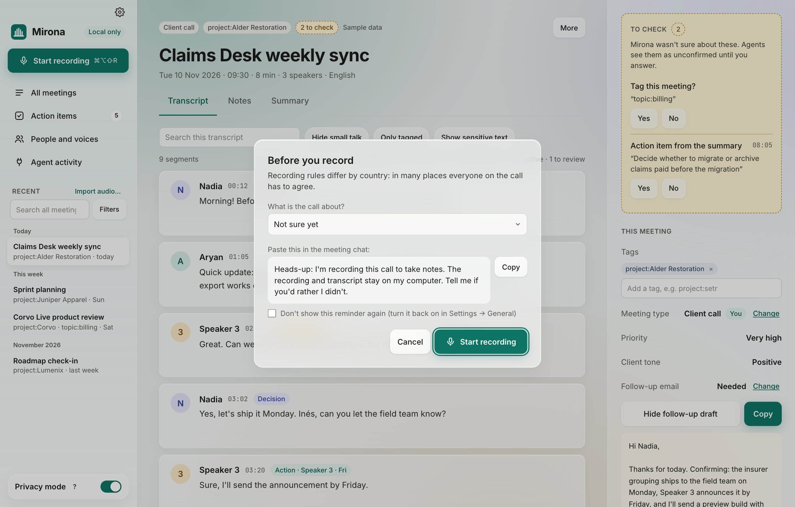
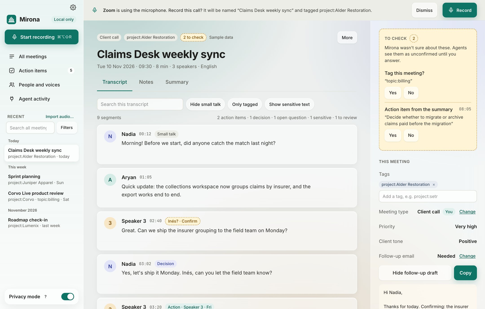
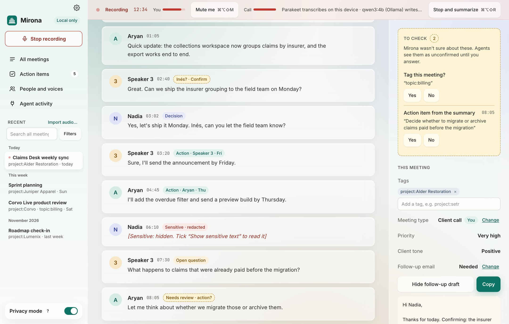

# Recording

Mirona records two things at once: your **microphone** ("Me") and your Mac's **system audio**
("Them": everyone you hear through your speakers or headphones). It transcribes both live, on
your Mac, then works out who said what when you stop.

## Starting a recording

Start from whichever is closest:

| Where | How |
| --- | --- |
| Sidebar | **Start recording** |
| Menu bar | Click the Mirona icon, then the big **Start recording** button |
| Anywhere | <kbd>⌘⌥⇧R</kbd> (change it in Settings › General › Record shortcut) |
| A call starts | **Record** in the banner Mirona shows when a call app opens the microphone |
| Terminal | `mirona record` (see [CLI and MCP](../cli-and-mcp.md)) |

Only one recording runs at a time, across the app and the CLI.

### The menu bar popover

Closing the main window keeps Mirona running in the menu bar, so the shortcut and the popover
keep working. Click the icon to open the popover:

- **Start recording** / **Stop recording**, with the elapsed time while recording.
- **Mute me**: mute your mic in the recording (see [Muting yourself](#muting-yourself)).
- **Open Mirona** and **Settings**.
- **Quit Mirona** (<kbd>⌘Q</kbd>). Quitting is the only way to close Mirona completely.

While recording, the menu bar icon's bars move like a sound meter next to a red dot. While you're
muted, the dot becomes a crossed-out mic.

## The consent reminder

Recording laws differ by country, and in many places everyone on a call has to agree. Before each
recording, Mirona asks what the call is about and shows a message to paste in the meeting chat:

- **What is the call about?** Pick one of your [tags](tags.md), or leave *Not sure yet*. The tag
  is added to the meeting right away.
- **Copy** puts the message on the clipboard. Edit the text in Settings › General › Consent
  reminder.
- **They agreed: don't remind me again for *tag* calls** skips the reminder next time you record a
  call with that tag. Useful for your own team.
- **Don't show this reminder again** turns it off everywhere (Settings › General brings it back).

Mirona can't check that people agreed. The reminder is there so you don't forget to ask.

## Call detection

With Settings › General › Call detection › **Suggest recording when a call starts** on, Mirona
notices when a call app starts using the microphone and offers to record:

It knows Zoom, Microsoft Teams, Webex, Slack, FaceTime and Discord, and these browsers (for
Google Meet and other web calls): Safari, Chrome, Arc, Dia, Edge, Firefox (including Developer
Edition and Nightly), Zen, Chromium, Brave, Opera, Opera GX, Vivaldi and Yandex. A browser using
the mic counts as a call, since Mirona can't tell a Meet tab from any other tab.

### Calendar titles and recording without a click

Turn on **Use calendar event titles** (it asks for calendar access once) and a detected call is
named after its calendar event, so the banner reads *It will be named "Claims Desk weekly sync"*.
That's the event running now or starting within 5 minutes (you joined early); if there are
several, the one starting closest to now. If the event title names one of your tags, the meeting
gets that tag too.

Below that, you can tick tags to **record without asking**: when a call starts and the event title
names a ticked tag, Mirona starts recording on its own. `project:setr` matches an event called
"Setr sync". Nothing else ever starts a recording by itself.

## While you record

The red bar at the top shows the elapsed time, a level meter for **You** and for the **Call**,
which models are working, and **Stop and summarize**.

The transcript fills in as people talk:

- Lines are split into **Me** and **Them** for now. A note at the top says so: the other side is
  told apart into separate speakers after the call.
- A line still being spoken shows in *italics* with "Still speaking…" and grows as the sentence
  goes on. When the sentence ends, it becomes a normal line.
- Each finished line is **tagged** as an action item, decision, open question, small talk or
  sensitive. You can [check why](meetings.md#inspecting-a-line) by clicking it, even mid-call.

Use the **Notes** tab to write as you go. Each line you type is stamped with the time, so the
enhanced notes can link it to that moment in the transcript.

### Muting yourself

Muted in the call and talking to someone in the room? Click **Mute me** in the recording bar,
use the menu bar popover, or press <kbd>⌘⌥⇧M</kbd> (Settings › General › Mute shortcut). Until you
unmute, your mic records **silence**: nothing you say reaches the transcript, the summary or the
audio file, and timestamps stay in sync. Each recording starts unmuted.

## When you stop

Click **Stop and summarize** or press the record shortcut again. Mirona then works through these
steps, showing progress as it goes:

1. Compresses the audio (Opus, about 11 MB an hour), splits "Them" into each speaker, and
   matches voices it already knows.
2. Joins each speaker's turn into one line, across short pauses (now that each line has its
   speaker), and tags any lines still untagged. Open questions are checked again against what
   was said after them, so a question answered later in the meeting isn't left open.
3. Answers the **meeting questions**: what type of meeting it was, its priority, the other side's
   tone, whether it needs a follow-up email, and which of your tags fit.
4. Writes the **summary** and **enhanced notes** from the template that matches the meeting type,
   and drafts a **follow-up email** when one is needed. If none of your tags fit, it may suggest
   one new tag.
5. Indexes the lines for search by meaning.

A meeting still called "New meeting" takes a short title from its summary. A name you or the
calendar gave is never replaced.

How long this takes depends on the length of the call, your Mac and the summary model. You can
keep working, and even start another recording, meanwhile. The summary streams in as it's
written.

## Importing a recording

Have a voice memo, a Zoom recording or an interview on file? **Import audio…** in the sidebar
(or **Import an audio file…** before your first meeting) transcribes it the same way: wav, mp3,
m4a, flac, aac and mp4. Progress shows in the sidebar, and the result is a normal meeting with
speakers, tags and a summary.

From the terminal: `mirona import ~/Downloads/interview.m4a`.

## Tips for a good recording

- **Headphones are fine.** Mirona records system audio before it reaches your headphones, so
  you hear the call as usual and Mirona still gets it.
- **Bluetooth headsets** (AirPods and others) switch to a lower-quality mode when their mic is
  in use. Mirona handles the switch, but a wired or built-in mic transcribes better.
- **In-person meetings:** everyone in the room is heard through your mic, and the mic side is
  always "You", so the room isn't split into speakers. For a room conversation you want split,
  record it on a phone or recorder and use [Import audio](#importing-a-recording).
- **One language per meeting, English for now.** The default speech model (Parakeet) is
  English-only. See the [FAQ](faq.md#does-mirona-work-in-other-languages).
