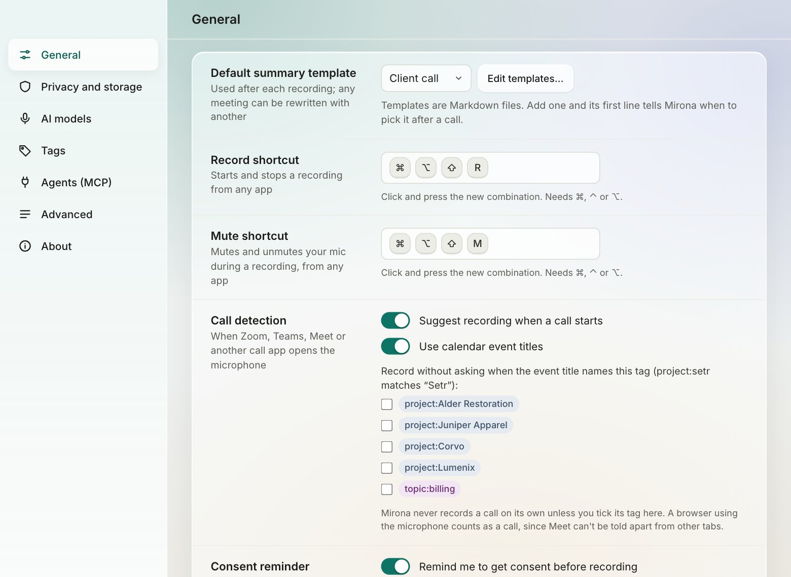
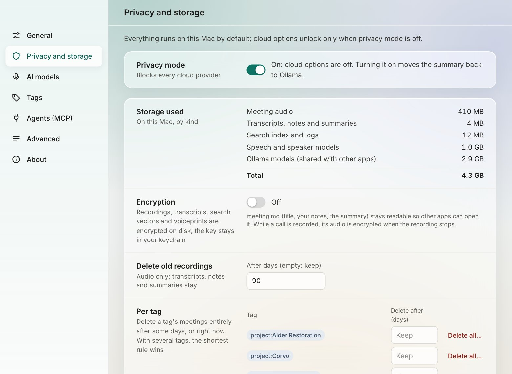
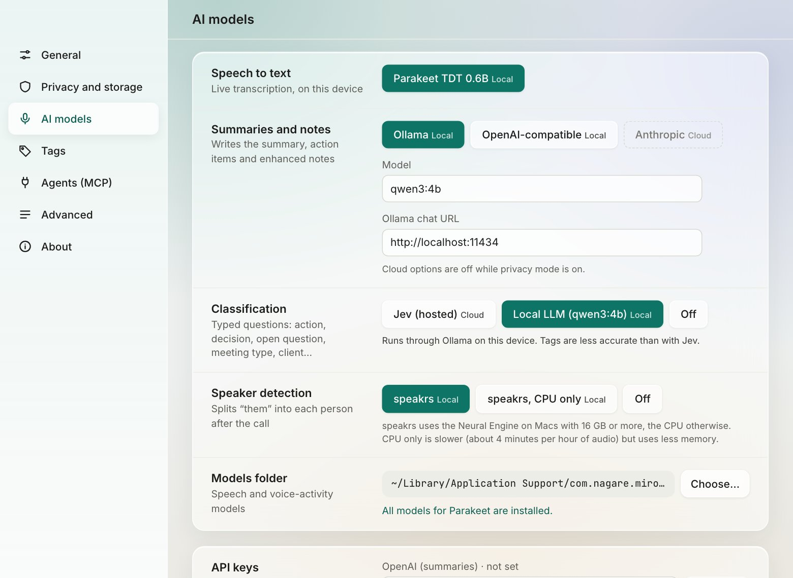
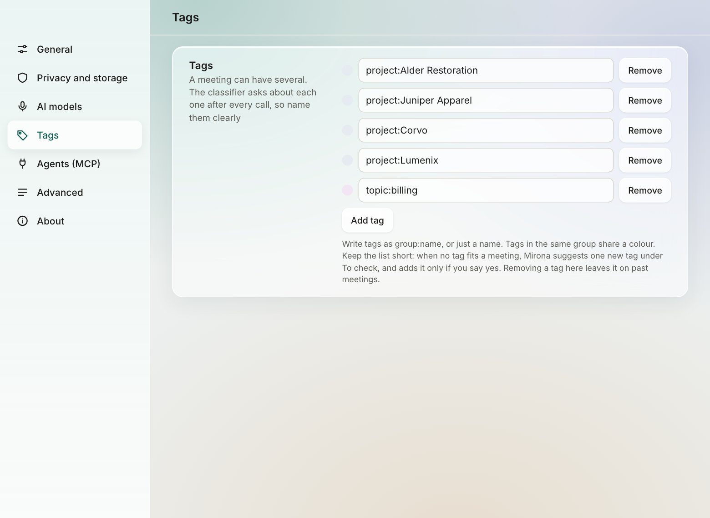
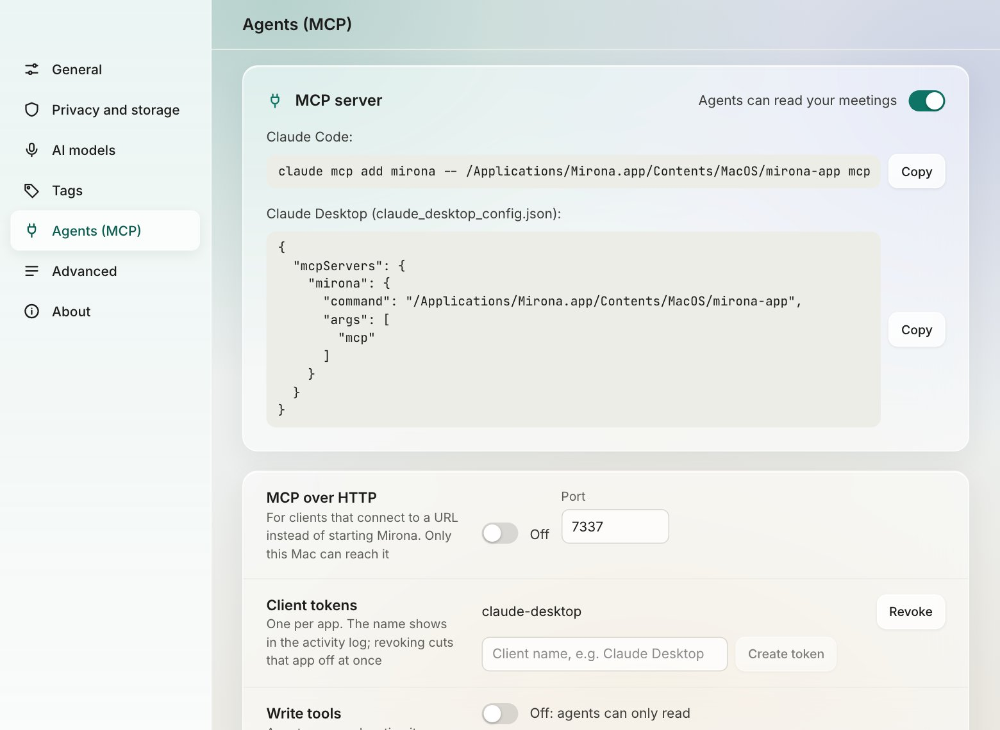
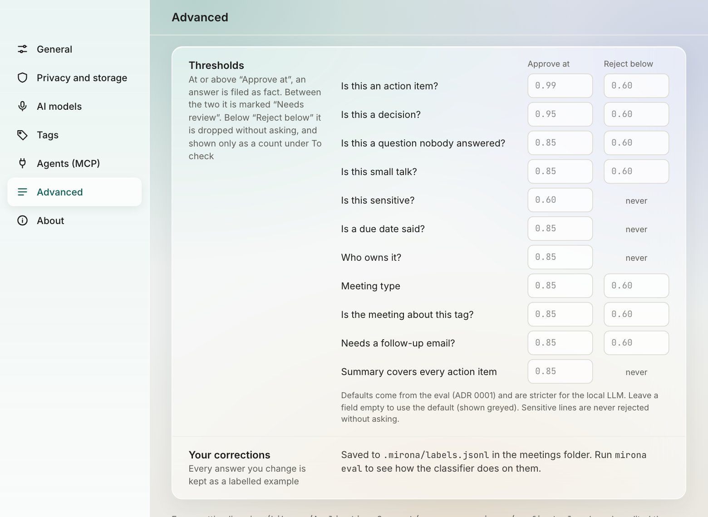
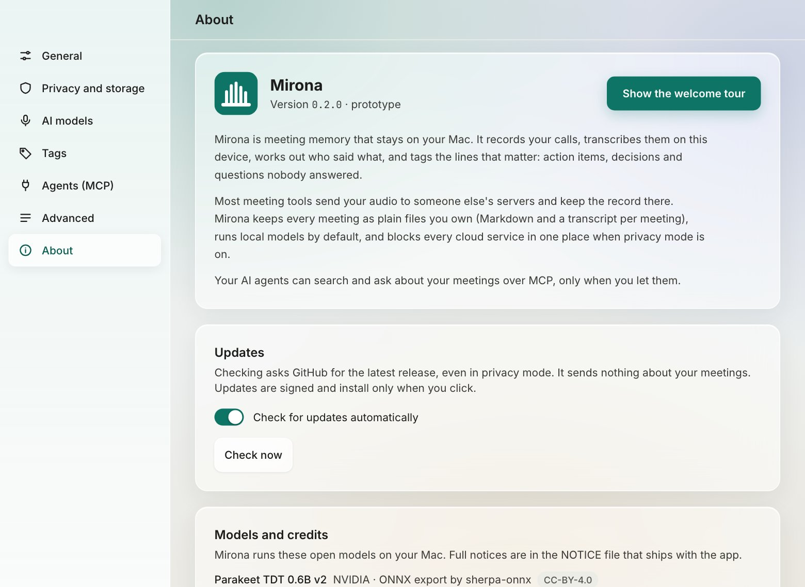

# Settings reference

Open Settings with <kbd>⌘,</kbd>, the gear at the top of the sidebar, or **Settings** in the menu
bar popover. Settings open in their own window, and changes apply at once (there's no Save
button). Everything is stored in `~/Library/Application Support/com.nagare.mirona/config.toml`,
except API keys and the encryption key, which are in the macOS keychain.

## General

| Setting | What it does | Default |
| --- | --- | --- |
| **Default summary template** | Used when the meeting type isn't certain. **Edit templates…** opens the templates folder. See [Templates](summaries.md#templates). | Client call |
| **Record shortcut** | Starts and stops a recording from any app. Click the field and press the new combination; it needs ⌘, ⌃ or ⌥. | <kbd>⌘⌥⇧R</kbd> |
| **Mute shortcut** | Mutes and unmutes your mic during a recording. Must differ from the record shortcut. | <kbd>⌘⌥⇧M</kbd> |
| **Call detection** › Suggest recording when a call starts | A banner offers to record when a call app opens the mic. See [Call detection](recording.md#call-detection). | On |
| **Call detection** › Use calendar event titles | Names meetings after the calendar event happening now, and lets you tick tags to record without asking. Asks for calendar access. | Off |
| **Consent reminder** | Asks what the call is about and shows a message to paste before each recording. Edit the message here; *Already agreed, no reminder* lists tags you've skipped, each with a button to bring the reminder back. | On |
| **Meetings folder** | Where meetings are saved, one folder each. **Choose…** moves to another folder (stop any recording first). | `~/Documents/Mirona` |

## Privacy and storage

| Setting | What it does | Default |
| --- | --- | --- |
| **Privacy mode** | Blocks every cloud provider. See [Privacy mode](privacy.md#privacy-mode). | On |
| **Storage used** | Disk used by audio, text, the index, models and Ollama's models. | – |
| **Encryption** | Encrypts recordings, transcripts, search vectors, voiceprints and corrections on disk. | Off |
| **Delete old recordings** | Deletes audio after this many days; text stays. Empty keeps audio. | Keep |
| **Per tag** | Deletes a tag's meetings after this many days; **Delete all…** does it now. | Keep |

## AI models

| Setting | Choices | Default |
| --- | --- | --- |
| **Speech to text** | Parakeet TDT 0.6B (Whisper in builds that include it) | Parakeet |
| **Summaries and notes** | Ollama, OpenAI-compatible, Anthropic; plus the model name and the server URL | Ollama, `qwen3:4b` |
| **Classification** | Jev (hosted), Local LLM (`qwen3:4b`), Off | Jev; the local LLM while privacy mode is on or without a Jev key |
| **Speaker detection** | speakrs, speakrs CPU only, Off | speakrs |
| **Models folder** | Where the speech and voice models are. Shows what's missing, with a download button. | `~/Library/Application Support/com.nagare.mirona/models` |
| **API keys** | OpenAI, Anthropic and Jev keys, saved in the keychain. | – |

Cloud choices are greyed out while privacy mode is on. See
[Summaries, templates and models](summaries.md).

## Tags

Your list of tags. Edit a name to rename it everywhere, **Remove** to take it off the list, **Add
tag** to add one. See [Tags](tags.md).

## Agents (MCP)

| Setting | What it does | Default |
| --- | --- | --- |
| **MCP server** › Agents can read your meetings | Lets MCP clients read meetings. Shows ready setup lines for Claude Code and Claude Desktop. | Off |
| **MCP over HTTP** | Serves MCP on `127.0.0.1` for clients that connect to a URL. Port is editable. | Off, port 7337 |
| **Client tokens** | One token per HTTP client; **Revoke** cuts it off. | – |
| **Write tools** | Lets agents mark action items done and rename speakers. | Off |
| **Sensitive lines** | Lets agents read sensitive lines when they ask for them. | Off |

See [AI agents](agents.md).

## Advanced

**Thresholds** sets, for each question the classifier answers, how sure it must be:

- **Approve at**: at or above it, the answer is filed as fact.
- **Reject below**: below it, the answer is dropped without asking (counted under To check).
- In between: the answer goes to **To check**.

Leave a field empty to use the default (shown greyed). Defaults depend on the classifier: the local
model is stricter because it tends to be overconfident. *Never* means that question is never
rejected without asking (sensitive lines, owners, due dates).

**Your corrections** shows how many answers you've changed. They're saved to
`.mirona/labels.jsonl` in the meetings folder; `mirona eval` scores the classifier on them.

## About

- The version, what Mirona is, and **Show the welcome tour**.
- **Updates**: **Check for updates automatically** (on start and daily; off by default) and
  **Check now**. The check asks GitHub for the latest release and sends nothing about your
  meetings. When an update is out, a banner offers **Install and restart**, and **What's new**
  opens its release notes. Updates are signed, and install only when you click.
- **Models and credits**: the open models Mirona runs, with their licenses.
