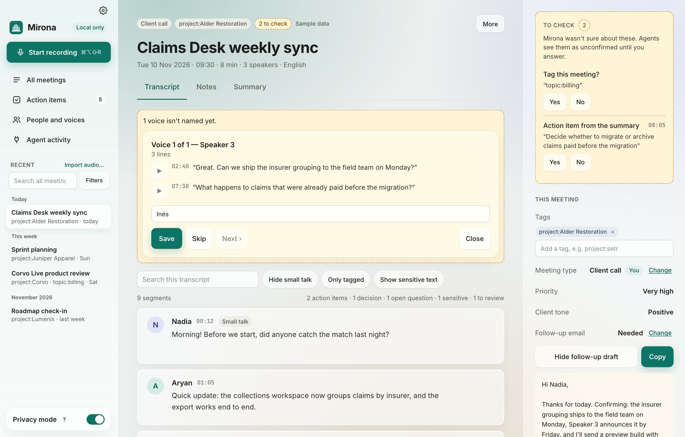
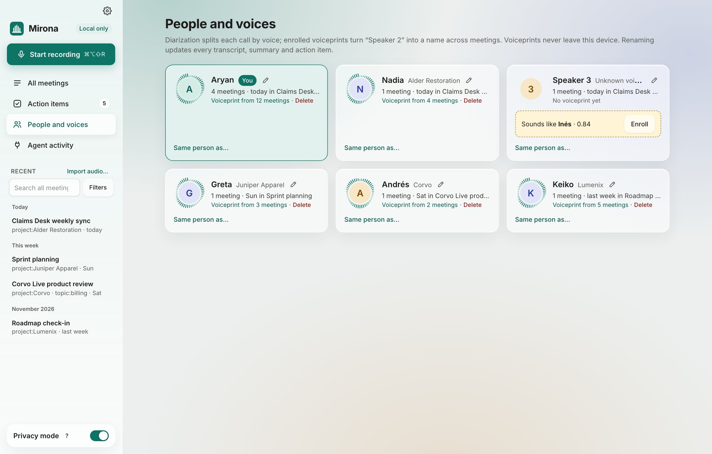

# Speakers and voices

During a call, lines are only split into **Me** (your mic) and **Them** (everyone else). When you
stop, Mirona listens to the other side's audio again (kept apart from your mic, so your voice
never gets mixed into theirs), tells the voices apart, and matches them against voices it
already knows. A voice nobody has named yet shows as *Speaker 2*,
*Speaker 3* and so on.

Your mic is always **You**. Voiceprints never leave your Mac.

## Naming new voices

When a call ends with voices nobody has named, a note above the transcript says how many.
**Name them** goes through them one at a time:

- Each voice shows its three clearest lines. Press ▶ to hear who it is.
- Type a name, or pick someone you already know (people from this meeting are listed first). A
  name typed in another case (*ines* for *Inés*) picks the existing person.
- **Save** (the button in the name field's row) adds the name as a pending change and moves to the
  next voice. **Skip** leaves it for later; the note stays until every voice has a name.

Name a voice once and Mirona recognises it in later meetings, and the name is filled in on every
transcript, summary and action item where that voice spoke.

### Suggestions

When a voice is close to someone you know, but not close enough to be sure, the line shows a
suggestion like **Inés? · Confirm**. Mirona also picks up names from the conversation itself
("Inés, can you…"). Click **Confirm** to accept, or name the voice yourself.

## Saving speaker changes

Renaming a voice, moving a line (in the transcript or in **Split voices**), naming a voice in
**Name them** and confirming a suggestion don't change the meeting yet. They wait as pending
changes, and a bar above the transcript counts them with **Save** and **Discard**:

- The old name shows struck out on red and the new one highlighted (~~Speaker 2~~Inés), on every
  line it will change, in the bar, and in the Summary tab (summary text and action item owners).
- **×** next to a change undoes just that one. Click the new name to change it again.
- **Save** applies every change together. **Discard** drops them all.
- Opening another meeting with unsaved changes asks whether to save, discard, or stay. Changes
  can't be saved while the meeting is still recording or being processed, and quitting Mirona
  drops them.

## A line went to the wrong person

Click the speaker's name on the line (or hover it and click **Who said this?**), then pick who
said it: someone you know, another voice from this meeting, **Me**, or a new name. Mirona then
asks:

- **Only this line** moves just that line.
- **All N lines by Speaker 2** renames the whole voice, in this meeting and wherever that voice
  was heard. Lines you already moved on their own keep that change.

A moved line keeps its person when you re-run speaker detection, and moving lines never changes
anyone's voiceprint. Your mic lines can be moved too, for when someone else's voice reached your
mic.

**It's me.** Pick **Me** (or type the name you gave yourself) when a voice was really you. Its
lines move to you, and Mirona forgets that voice instead of saving it under your name, so other
people are never mistaken for you later.

## Split voices

When voices are badly mixed up, **Split voices…** (above the transcript) shows every voice as a
column of its lines:

- Drag a line to the column of whoever said it, or use the line's **Move to…** menu. Press ▶ to
  hear it first.
- **Someone else**: type a name, then drop their lines there.
- Moves wait for **Save** like any other speaker change; **×** on a moved line undoes it.
- **Sensitivity** finds voices again. Slide right (**More voices**) when two people were merged
  into one, or someone who barely spoke got folded into another voice. Slide left (**Fewer
  voices**) when one person was split in two. Lines you moved stay where you put them. With
  changes still waiting, it asks you to save or discard them first.

## People and voices

**People and voices** in the sidebar lists everyone Mirona has heard:

Each card shows:

- the name (✎ renames them everywhere), and *You* on your own card
- how many meetings they were in, and the latest one
- **Voiceprint from N meetings**: how many recordings their voice was learned from. More
  meetings make recognition more reliable.
- **Delete** removes the voiceprint. The person and their name stay on past meetings, but Mirona
  stops recognising them in new ones until you name their voice again.
- **Sounds like *name* · 0.84 · Enroll** on unknown voices close to someone: **Enroll** adds this
  voice to that person.
- **Same person as…** merges two people who are the same (for example *Inés* and *Ines R.*).
  Their meetings, lines and voiceprints are combined.

## Tips

- **Name voices soon after a call.** The more meetings a voice is named in, the better Mirona
  recognises it.
- **Short speakers** (under about 20 seconds) don't get a voice of their own by default; their
  lines go to the closest voice. Use **Split voices…** with the sensitivity slid right, or move
  their lines by hand.
- **Speaker detection off?** In Settings › AI models › Speaker detection you can choose
  *speakrs* (uses the Neural Engine on Macs with 16 GB or more), *speakrs, CPU only* (slower,
  uses less memory) or *Off* (everyone else stays "Them").
- Agents with write access can rename speakers too (see [AI agents](agents.md)).
