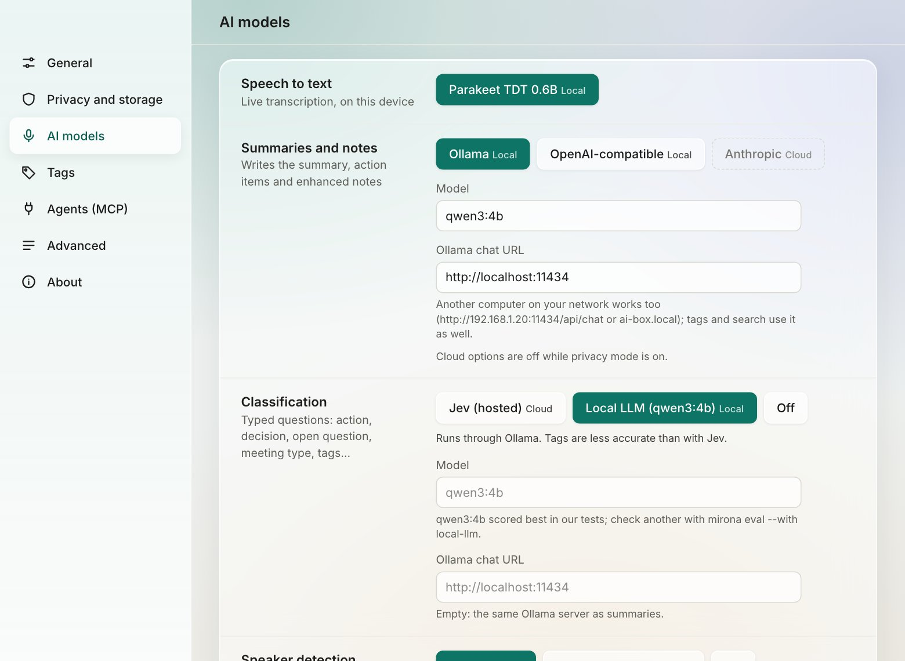

# Summaries, templates and models

## Which model does what

Mirona uses a different model for each stage. Settings › **AI models** picks them:



| Stage | What it does | On your Mac | Cloud (privacy mode off) |
| --- | --- | --- | --- |
| **Speech to text** | Live transcription | Parakeet TDT 0.6B (default). Whisper only in builds with the `whisper` feature | – |
| **Speaker detection** | Splits "Them" into people, matches known voices | speakrs (Neural Engine on 16 GB+ Macs, CPU otherwise), or CPU only | – |
| **Classification** | Tags lines, answers the meeting questions | Local LLM (`qwen3:4b` in Ollama by default, any Ollama model) | Jev (TypeSafe) |
| **Summaries and notes** | Summary, enhanced notes, follow-up email, task wording, tag suggestions | Ollama (`qwen3:4b` by default), or an OpenAI-compatible server on this Mac (LM Studio, vLLM…) | OpenAI-compatible (default `gpt-4.1-mini`), Anthropic (default `claude-opus-5-5`) |
| **Search by meaning** | Embeddings for search | Ollama `nomic-embed-text` | – |

Speech, speakers and search always run on your Mac. Classification and summaries can use a cloud
model only with privacy mode off, and only once you add your key.

### Using a different local model

Any model Ollama serves works. Pull it, then type its name in Settings › AI models › Summaries and
notes › Model:

```bash
ollama pull qwen3:8b     # better summaries, needs more memory
```

Bigger models write better summaries but take longer and need more memory. `qwen3:4b` is the
default because it runs comfortably on a 16 GB Mac.

**LM Studio, vLLM or another local server:** pick **OpenAI-compatible** and set the base URL to
the server on this Mac (for LM Studio, `http://localhost:1234/v1`). Servers on `localhost` or
your local network count as local, so they work in privacy mode.

**Models on another computer:** if a stronger machine on your network (an AI workstation, a
gaming PC) runs Ollama, the Mac only has to record and transcribe.

1. On that computer, pull the models (`ollama pull qwen3:4b`, `ollama pull nomic-embed-text`)
   and start Ollama so it listens on the network: `OLLAMA_HOST=0.0.0.0 ollama serve`.
2. In Settings › AI models, set **Ollama chat URL** to that computer, e.g.
   `http://192.168.1.20:11434/api/chat` or `http://ai-box.local:11434/api/chat`.

Summaries, tags and search by meaning then all run there. Private addresses (`10.x`,
`172.16–31.x`, `192.168.x`), Tailscale (`100.64–127.x`) and `.local` names count as local, so
privacy mode allows them; plain names like `http://ai-box` don't, use its IP or `.local` name.
Transcription and speaker naming stay on the Mac. The traffic is plain HTTP: on a network you
don't trust, use Tailscale or an SSH tunnel (`ssh -N -L 11434:localhost:11434 ai-box`, then
keep the URL on `localhost`).

**A different model for tags:** Settings › AI models › Classification › **Model** and **Ollama
chat URL** (shown while the local LLM tags). Empty, tags use `qwen3:4b` on the summary's server.
`qwen3:4b` scored best in our tests; before switching, compare a bigger model on your own
meetings: `mirona eval --with local-llm` uses the model set here.

### Using a cloud model

1. Turn **privacy mode** off (sidebar, or Settings › Privacy and storage).
2. Settings › AI models › **API keys**: paste your OpenAI, Anthropic or Jev key. Keys are stored
   in the macOS keychain, never in config files, and sent only to their own provider.
3. Pick **OpenAI-compatible** or **Anthropic** under Summaries and notes, and **Jev** under
   Classification if you have a key.

Jev classifies more accurately than the local model, so tags and action items are better with
it. Without a Jev key, the local model answers. See [Privacy](privacy.md) for exactly what each
provider receives.

## Templates

Each summary is written from a **template**: a Markdown file saying which sections to write and
what goes in each. Mirona ships four, one per meeting type: **Client call**, **Standup**, **1:1**
and **Planning** (sprints, roadmaps, projects). All four have the same sections (Overview,
Decisions, Action items, Open questions), with instructions tuned to that kind of meeting.

After each call, the **meeting type** picks the template when the classifier is sure of it.
Otherwise Settings › General › **Default summary template** is used. Any meeting can be rewritten
with another template from its Summary tab (**Template**, then **Regenerate**).

### Editing a template

Templates live in `~/Library/Application Support/com.nagare.mirona/templates/`. Settings ›
General › **Edit templates…** opens the folder in Finder. Here's the built-in client call template:

```markdown
# Client call

A call with a client. Edit this file to change how client calls are summarized.

## Overview
Two to four sentences: why the call happened, what the client asked for or agreed to, and where the project stands.

## Decisions
What was agreed with the client: scope, dates, prices, priorities.

## Action items
Who promised what to whom, with the due date when one was said. Note both our commitments and the client's.

## Open questions
Anything the client or we still need to answer, including unclear scope or pending approvals.
```

- The `# Heading` is the template's name.
- The **first line** under it says what kind of meeting it's for.
- Each `## Section` becomes a part of the summary; the text under it tells the model what to
  write there.

Changes apply to the next summary. Existing summaries stay until you regenerate them.

### Your own templates

Add a new `.md` file to the folder and it becomes a **meeting type** of its own: after each call,
the classifier considers it alongside the built-in types, using its name and first line. Write the
first line so it's easy to tell apart from the others.

**Example: sprint retrospectives.** Save this as `sprint-retro.md`:

```markdown
# Sprint retro

A sprint retrospective: what went well, what didn't, and what the team will change next sprint.

## Went well
Things the team wants to keep doing, with who raised them.

## Didn't go well
Problems and frustrations, stated plainly. No blame, no names unless someone volunteered.

## We'll change
Concrete changes for the next sprint, each with an owner.

## Action items
Who promised what, with the due date when one was said.
```

**Example: sales demos.** `sales-demo.md`:

```markdown
# Sales demo

A product demo for a prospect: their needs, objections, and the next step in the deal.

## The prospect
Who they are, what they do today, and what problem brought them here.

## What resonated
Features or points they reacted well to.

## Objections
Concerns about price, fit, timing or competitors, and how we answered.

## Next step
The agreed next meeting or decision, with dates.

## Action items
Who promised what to whom, with the due date when one was said.
```

Other ideas: `interview.md` (candidate, strengths, concerns, recommendation), `board-meeting.md`
(resolutions, votes, risks), `user-research.md` (participant, quotes, pain points, ideas).

The Settings lists refresh when you come back to Mirona, so a new template shows up without a
restart. A deleted built-in template comes back the next time Mirona reads the folder, so edit it
instead of deleting it.

> **Privacy note:** with privacy mode off and Jev picked for classification, your template names
> and first lines are sent to Jev with the meeting questions, so Jev can pick the type.

## Enhanced notes and follow-up emails

The same model writes the **enhanced notes** (your notes, expanded with the transcript) and the
**follow-up email**, drafted only when the classifier thinks the call needs one. Neither ever
includes sensitive lines. The follow-up draft is in the inspector under **This meeting ›
Follow-up email**.
