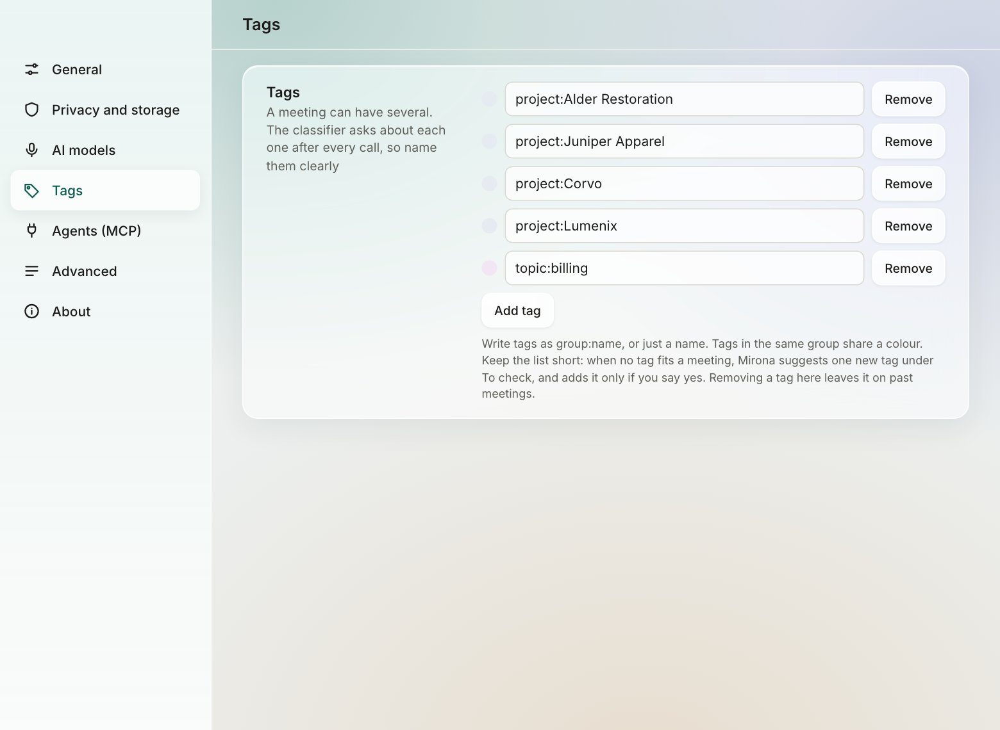

# Tags

Tags say what a meeting is about: the client, the project, the topic. A meeting can have several.
Mirona adds them for you after each call, and they drive filters, search, retention rules and the
consent reminder.

## Naming tags

A tag is either `group:name` or just a name:

| Tag | Use it for |
| --- | --- |
| `project:Alder Restoration` | A client or project |
| `team:platform` | An internal team |
| `topic:billing` | A recurring subject that cuts across projects |
| `hiring` | Anything that doesn't need a group |

Case doesn't matter. Tags in the same group share a colour everywhere (all `project:` tags look
alike); tags without a group are grey.

**Name tags clearly.** After each call, the classifier asks one yes/no question per tag ("Is this
meeting about *project:Alder Restoration*?") using the name alone. `project:setr` works;
`p1` doesn't.

## Managing your tags

Settings › **Tags** lists them:

- **Add tag** adds one. Keep the list short: every tag is one more question after each call.
- Edit a name in place to **rename** it. The tag is renamed on every meeting and in every rule
  that uses it.
- **Remove** takes it off the list. It stays on past meetings, and Mirona stops suggesting it.

A tag you type on a meeting that isn't on the list yet joins the list.

## How Mirona tags a meeting

After each call:

- A **sure** "yes" adds the tag.
- An **unsure** one waits in **To check** as *Tag this meeting?*.
- Mirona **never removes** a tag, and never changes a tag you set, removed or answered.

You can also tag a meeting yourself:

- in the [consent reminder](recording.md#the-consent-reminder), before recording
- from the calendar: a call whose event title names a tag gets it
  ([call detection](recording.md#calendar-titles-and-recording-without-a-click))
- in the inspector's **This meeting › Tags**: × removes a tag; type to add one. Suggestions match
  any part of a tag: "setr", "proj" or even "pset" find `project:setr`.

### Suggested tags

When no tag fits a meeting, Mirona may suggest **one** new tag from the summary, shown in To check
as *New tag?*. **Yes** adds it to the meeting and to Settings › Tags; **No** drops it.

## What tags are used for

| Where | What it does |
| --- | --- |
| Sidebar and All meetings | Shown under each meeting; **All tags** filters the list |
| Search | **Filters** › meeting tag narrows results (`project:` matches every project) |
| Action items | **All tags** narrows the list to one client or project |
| Consent reminder | *They agreed* skips the reminder for that tag's calls |
| Call detection | Tick a tag to record its calendar calls without asking |
| Retention | Delete a tag's meetings after some days (Settings › Privacy and storage › Per tag) |
| CLI and agents | `--meeting-tag`, `--tag` and `meeting_tag` filter by tag |

## Upgrading from 0.1.0

Clients from Mirona 0.1.0 become `project:` tags automatically, with their rules. Tag descriptions
from earlier versions are dropped.
