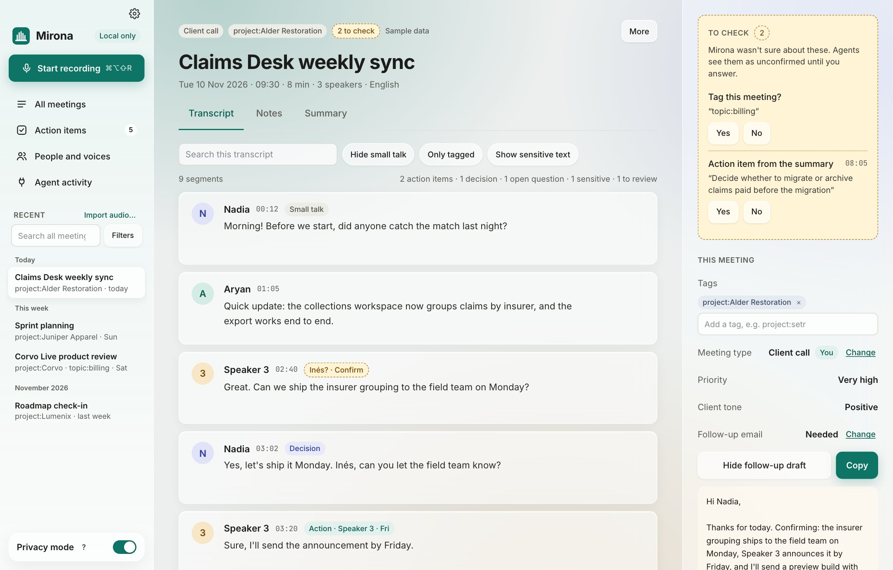

# User guide

Mirona records your calls, transcribes them on your Mac, works out who said what, and keeps every
meeting as Markdown files you own. This guide covers everything you can do with it.

## Start here

- **[Getting started](guide/getting-started.md)**: install, Ollama, the first-run setup and your
  first recording.
- **[Common workflows](guide/workflows.md)**: client calls, standups, 1:1s, interviews, in-person
  meetings, weekly reviews with your agent.
- **[FAQ and troubleshooting](guide/faq.md)**: quick answers, and what to do when something
  doesn't work.

## Using Mirona

| Chapter | What's in it |
| --- | --- |
| [Recording](guide/recording.md) | Every way to start, the menu bar, consent reminder, call detection, muting, what happens when you stop, importing audio |
| [A meeting, explained](guide/meetings.md) | Transcript, tags, the inspector, To check, notes, summary, follow-up email |
| [Speakers and voices](guide/speakers.md) | Naming voices, moving lines, merging people, voiceprints |
| [Tags](guide/tags.md) | Naming and managing tags, how Mirona tags meetings, suggested tags |
| [Action items, search and all meetings](guide/actions-and-search.md) | Action items across meetings, search by words and meaning, the meetings table |
| [Summaries, templates and models](guide/summaries.md) | Which model does what, local and cloud models, editing templates, your own meeting types |
| [Privacy, encryption and retention](guide/privacy.md) | Privacy mode, sensitive lines, encryption, deleting old recordings |
| [AI agents (MCP)](guide/agents.md) | Connecting Claude and other agents, what they can do, things to ask |
| [Settings reference](guide/settings.md) | Every setting, tab by tab, with defaults |
| [Files and folders](guide/files.md) | Where everything is, `meeting.md`, backups, uninstalling |

For the `mirona` command and the full MCP tool reference, see [CLI and MCP](cli-and-mcp.md).
What can leave your Mac, and when, is in [PRIVACY.md](../PRIVACY.md).

## At a glance

| To | Do |
| --- | --- |
| Start or stop recording | <kbd>⌘⌥⇧R</kbd>, the sidebar button, or the menu bar icon |
| Mute your mic in a recording | <kbd>⌘⌥⇧M</kbd> or **Mute me** |
| Open Settings | <kbd>⌘,</kbd> |
| See why a line was tagged | Click the line |
| Fix a misheard line | Hover it › **Fix text** |
| Move a line to another person | Hover it › **Who said this?** |
| Rewrite a summary | Summary tab › **Template** › **Regenerate** |
| Send the follow-up | Inspector › Follow-up email › **Copy** |
| Find something said weeks ago | **Search all meetings** at the top of the sidebar |
| Import a recording | **Import audio…** in the sidebar |
| Hide Mirona but keep it recording | Close the window; it stays in the menu bar |

The screenshots in this guide use Mirona's demo meetings: made-up people and companies.
